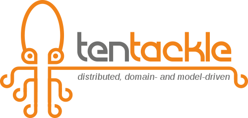

> **Tentackle is a Java framework for building multi-tier applications around a single
> domain model. Its entities are Persistent Domain Objects — persistence and domain
> logic in separate classes, united behind one interface. They travel between JVMs as
> real objects, so any of their methods can be called in any JVM, on any tier, with
> no REST plumbing in between.**

Two ideas carry the framework, and each makes the other possible.

**Persistent Domain Objects.** An `Invoice` is one interface backed by two
independent implementations: the persistence side — attributes, relations, finders,
`persist()` — generated from the model, and the domain side — `approve()` — written
by hand. Neither class knows the other. They are woven together at runtime into a
single object behind a dynamic proxy that behaves as if it inherited from both:
multiple inheritance, emulated. Business rules never touch SQL or a wire format,
and the generated persistence code never depends on a business rule.

**Location transparency.** This is not about invoking methods on objects that stay
on a server. The PDO itself travels between JVMs — physically, serialized by
[TRIP](tentackle-core/src/main/docs/trip.md), Tentackle's compact binary protocol —
and arrives with its state and its domain logic. It is no stub and no DTO: its
methods run in the JVM that currently holds it, and because the persistence side is
remoting-capable, only what needs the database goes over the wire. Write
`invoice.approve()` once, in the domain layer, and call it from a server, an edge
node next to the machine, a web node, or a JavaFX desktop client — three tiers away
from the database, and it works: the object arrives fully alive, navigates its
relations on demand, and opens a real transaction on the tier that owns the
connection. There is no DTO layer, no endpoint, no fetch plan, and no
`LazyInitializationException` — the exception type does not exist here.

```java
// domain side of the Invoice PDO — written once, deployed everywhere
@Transaction
public void approve() {
  Customer customer = getCustomer();                    // persistence side: fetched on demand, locally or over the wire
  if (customer.getCreditLimit().compareTo(customer.openAmount()) < 0) {
    throw new DomainException("credit limit exceeded");
  }
  setState(InvoiceState.APPROVED);
  me().persist();                                       // me() is the whole PDO: validates the aggregate, then writes
}

// any client JVM, three tiers from the database — the entire call site
invoice.approve();
```

The domain code reaches the persistence side only through the PDO's interfaces, so
which implementation answers — JDBC or a remote delegate — is not its concern. Which
tier that code runs on is a connection URL in a properties file, not a decision
baked into the source.

Tentackle is Open Source (LGPL 2.1), available from
[Maven Central](https://search.maven.org/search?q=org.tentackle), and requires
Java 25 or later (older LTS lines are maintained on the `java21`, `java17`,
`java11` and `java8` branches).

## Why Tentackle?

Five things set Tentackle apart from other Java frameworks:

1. **Persistent Domain Objects (PDOs), not an ORM.** A PDO unifies persistence
   and domain logic behind one interface via runtime-injected proxies — emulated
   multiple inheritance that keeps the two concerns fully independent. There are
   no lifecycle states and **no `LazyInitializationException`, ever**.
   See [PDO](tentackle-pdo/src/main/docs/pdo.md) and
   [PDOs vs. Traditional ORMs](tentackle-pdo/src/main/docs/pdo-vs-orm.md).

2. **Write the domain logic once, run it on any tier.** The same artifact works
   whether the database is local, behind a middle-tier server, or reached through
   a cascade of nested servers — transparently, over
   [TRIP](tentackle-core/src/main/docs/trip.md), a compact binary protocol that
   replaces RMI/JOS with pluggable, SD-WAN-friendly transports (TLS, compression,
   pre-shared-key encryption, QUIC). The topology is pure configuration: a
   connection URL decides where each node sits. See the
   [Multi-Tier Cascade](src/main/docs/tiers.md).

3. **Correctness is the default, not an add-on.** Optimistic (`serial`) locking
   is always on, validation is declarative and travels with the object,
   aggregates are first-class citizens enforcing DDD boundaries and reverting
   atomically via snapshots, and shared objects can be made immutable. Whatever
   goes wrong fails loudly and early instead of corrupting data quietly. See
   [Correctness First](src/main/docs/correctness-first.md).

4. **One model — generated everywhere, and queryable by tools.** The model lives
   in the PDO interface and drives generation of the persistence layer, DDL and
   database migrations through the
   [Wurbelizer](tentackle-wurblets/src/main/docs/wurblets.md). Service discovery
   is resolved at compile time by the
   [ServiceFinder SPI](tentackle-common/src/main/docs/services.md) — no runtime
   classpath scanning, fast startup, and it works in both modular and classpath
   mode. That model is not locked away in a comment block, though:
   `mvn tentackle-mcp:serve` serves it *relation-resolved* — as the code generators
   see it — to coding agents over MCP, validating a candidate definition against the
   whole model in under a second, and the JavaFX wizards all run headless too. See
   [AI Agent Tooling Support](src/main/docs/ai-agents.md).

5. **True JPMS, self-contained apps.** Every module is a real
   [JPMS module](src/main/docs/modules.md); applications ship as self-contained
   jlink/jpackage images with built-in client
   [auto-update](tentackle-update/src/main/docs/update.md) and rich
   [JavaFX](tentackle-fx-rdc/src/main/docs/rdc.md) desktop clients.

## When to use Tentackle — and when not to

A framework that fits everything fits nothing. Tentackle makes a specific trade:
it gives up polyglot reach and ecosystem size to buy a single, coherent domain
model that runs unchanged on every tier. That trade is excellent for some projects
and a poor deal for others, so here is the honest filter.

### Tentackle is probably a good fit if…

- **You build both ends.** Java on the client (or the edge node) *and* Java on the
  server, shipped by one team from one model. This is the central assumption.
- **Your domain is rich and long-lived** — invariants, aggregates, workflows,
  business rules that outlive three UI rewrites — rather than CRUD over a table.
- **The topology is imposed on you, or simply awkward:** JVMs pinned to hardware,
  more than two tiers, NAT or a gateway in the middle, links that are slow, lossy,
  or without a PKI. See
  [Technical and Scientific Applications](src/main/docs/technical-scientific.md).
- **You need a real desktop client** — tables, trees, master/detail forms, keyboard
  workflows, auto-update — not a web page. `tentackle-fx-rdc` is a first-class
  citizen here, not an afterthought.
- **Being wrong is expensive.** Money, materials, measurements, regulated records:
  domains where a quietly corrupted row costs more than a night of downtime. See
  [Correctness First](src/main/docs/correctness-first.md).
- **You are tired of the DTO/mapper/fetch-plan layer** and would rather not
  maintain a second, weaker copy of your model just to move it between your own
  processes.

### Look elsewhere if…

- **You are building a stateless web API or microservices.** Use Quarkus, Spring
  Boot, or Micronaut. They are excellent at it, Tentackle is not aiming at it, and
  its location-transparency machinery solves a problem you do not have.
- **Your clients are browsers, mobile apps, or other teams' services.** They cannot
  speak TRIP and should not have to. You *can* put a Tentackle
  [web node](tentackle-web/src/main/docs/web.md) behind a REST edge — but if that
  edge is the whole product, the framework earns little.
- **You need polyglot services, or infrastructure you do not control.** Tentackle
  assumes JVM-to-JVM communication on a network you own.
- **You want to bolt it onto an existing Spring/JPA codebase.** Tentackle is a
  programming model, not a library you add to fix a DTO layer.
- **Two teams must deploy on genuinely independent schedules.** A shared domain
  model means coordinated releases; an organizational seam wants a negotiated wire
  contract instead.
- **It is a one-tier CRUD app**, or ecosystem size and hiring familiarity outrank
  architectural fit. Both are legitimate reasons to choose something else.
- **You need hard real-time.** Tentackle runs on a standard JVM. Its sweet spot is
  the soft-real-time layer *above* hard-real-time PLCs and firmware.

If you are weighing Tentackle against the alternatives at the tier boundary, the
detailed argument — with code on both sides — is in
[Location Transparency vs. REST, RMI and Spring Remoting](src/main/docs/remoting-comparison.md).

## Where to go next

- 🚀 **[Quickstart](src/main/docs/quickstart.md)** — generate, build, and run a
  complete multi-tier application in minutes.
- ⚖️ **[Tentackle vs. REST, RMI and Spring Remoting](src/main/docs/remoting-comparison.md)** —
  what the tier boundary costs in each approach, and where each one wins.
- 📚 **[Table of Contents](src/main/docs/toc.md)** — every document, grouped by topic.
- 🔎 **[Index](src/main/docs/index.md)** — look up a concept and jump straight to it.
- 🤖 **[AI Agent Tooling](src/main/docs/ai-agents.md)** — the MCP model server, the
  headless wizard batch modes, and the bundled agent skills.
- 🧾 **[Java site docs](https://tentackle.org/tentackle/)** — as a reference.

and for the impatient Java developer:

- 🔔 **[Concise Summary](src/main/docs/unexpected.md)** — main facts you might not expect
