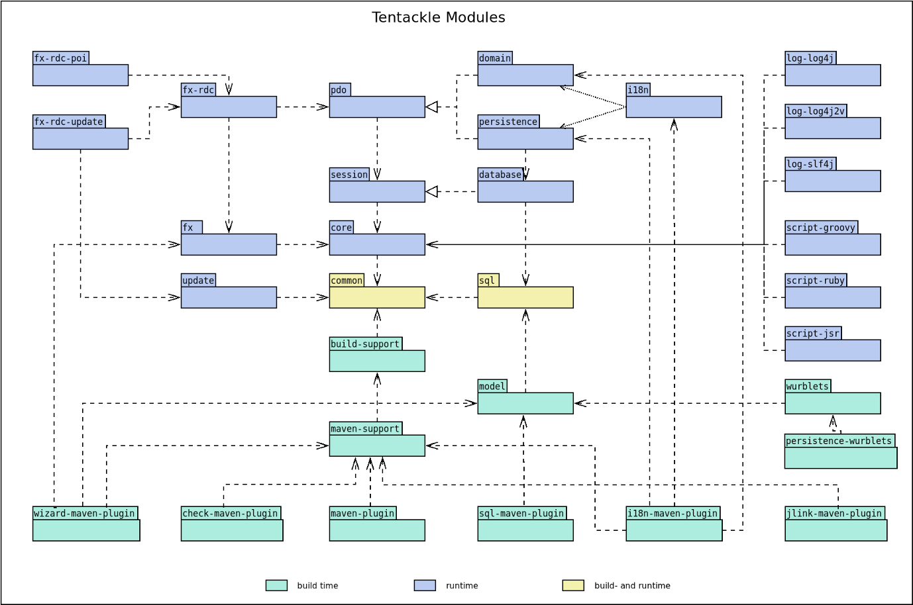

## Tentackle Modules

Tentackle is a modular Maven reactor. Every module falls into one of three kinds:

1. **runtime** — modules an application ships with;
2. **build-time** — Maven plugins and code-generation support;
3. **common** — shared by both build- and runtime.

### Named modules and automatic modules

Twenty artifacts — every module an application ships with, plus `tentackle-model` — are real
[JPMS](https://openjdk.org/projects/jigsaw/) modules with an explicit `module-info.java`:
`tentackle-common`, `-core`, `-sql`, `-model`, `-session`, `-database`, `-pdo`, `-persistence`,
`-domain`, `-i18n`, `-quic`, `-quiche`, `-update`, `-web`, `-fx`, `-fx-rdc`, `-fx-atlanta`, `-fx-rdc-update`,
`-log-slf4j`, `-log-log4j2v` and `-script-jsr`.

The remaining artifacts declare an `Automatic-Module-Name` in their JAR manifest instead. Those are
the build-time modules (the Maven plugins, `tentackle-maven-support`, `tentackle-build-support`, the
wurblets), the test-support modules (`tentackle-test-pdo`, `tentackle-test-fx-rdc`; the pure
test-scope `tentackle-pdo-mock` declares none, as it is only ever used on the test class path)
and the three providers whose third-party backends are themselves not
modularized (`tentackle-script-groovy`, `tentackle-script-ruby`, `tentackle-fx-rdc-poi`). They carry
a stable module name, so a modular application can `requires` them, but no compile-time module
descriptor. `tentackle-bom` and `tentackle-project-archetype` ship no code at all.

This is not a limitation of the programming model: the
[Service API](../../../tentackle-common/src/main/docs/services.md) resolves implementations from
`META-INF` data written at build time, so Tentackle applications run on the module path, the class
path, or a mix of both — and the
[jlink/jpackage plugin](../../../tentackle-jlink-maven-plugin/src/main/docs/jlinkpackage.md)
derives the right packaging category for each artifact by itself.

All artifacts are on [Maven Central](https://search.maven.org/search?q=tentackle).
A [BOM](../../../tentackle-bom/src/main/docs/bom.md), a [project archetype](../../../tentackle-project-archetype/src/main/docs/tentackle-project-archetype.md)
and the test-support modules ([tentackle-pdo-mock](../../../tentackle-pdo-mock/src/main/docs/pdo-mock.md),
[tentackle-test-pdo](../../../tentackle-test-pdo/src/main/docs/tentackle-test-pdo.md),
[tentackle-test-fx-rdc](../../../tentackle-test-fx-rdc/src/main/docs/tentackle-test-fx-rdc.md))
round out the set but are omitted from the diagram.

### The interface / implementation split

The defining structural idea: API modules declare *interfaces*, separate runtime modules *implement*
them, and the [Service API](../../../tentackle-common/src/main/docs/services.md) injects the
implementation at runtime — so the API stays agnostic of its backend.

| Interfaces (API)                                                         | Implemented by                                                                                                                                                                      |
|--------------------------------------------------------------------------|-------------------------------------------------------------------------------------------------------------------------------------------------------------------------------------|
| [tentackle-session](../../../tentackle-session/src/main/docs/session.md) | [tentackle-database](../../../tentackle-database/src/main/docs/database.md)                                                                                                         |
| [tentackle-pdo](../../../tentackle-pdo/src/main/docs/pdo.md)             | [tentackle-persistence](../../../tentackle-persistence/src/main/docs/persistence.md) (persistence) + [tentackle-domain](../../../tentackle-domain/src/main/docs/domain.md) (domain) |

### Runtime modules

| Layer       | Module                                                                                                                                                       | Role                                                                                                                                      |
|-------------|--------------------------------------------------------------------------------------------------------------------------------------------------------------|-------------------------------------------------------------------------------------------------------------------------------------------|
| Common      | [tentackle-common](../../../tentackle-common/src/main/docs/common.md)                                                                                        | Build- and runtime foundation: `@Analyze` and other annotations, datatypes, bundle and JPMS support, the service API.                     |
| Common      | [tentackle-sql](../../../tentackle-sql/src/main/docs/sql.md)                                                                                                 | Low-level, backend-agnostic database abstraction.                                                                                         |
| Core        | [tentackle-core](../../../tentackle-core/src/main/docs/core.md)                                                                                              | Runtime foundation: binding, validation, reflection/proxies/interceptors, tasks/daemon, preferences, plus the logging and scripting APIs. |
| Core        | [tentackle-i18n](../../../tentackle-i18n/src/main/docs/i18n.md)                                                                                              | Database-persisted I18N bundle support.                                                                                                   |
| Database    | [tentackle-session](../../../tentackle-session/src/main/docs/session.md) · [tentackle-database](../../../tentackle-database/src/main/docs/database.md)       | Session handling (interfaces + implementation).                                                                                           |
| Application | [tentackle-pdo](../../../tentackle-pdo/src/main/docs/pdo.md)                                                                                                 | Persistent Domain Object interfaces: entities, aggregates, components, operations, security, number sources.                              |
| Application | [tentackle-persistence](../../../tentackle-persistence/src/main/docs/persistence.md) · [tentackle-domain](../../../tentackle-domain/src/main/docs/domain.md) | The persistence- and domain-side PDO implementations, injected at runtime.                                                                |
| Application | [tentackle-update](../../../tentackle-update/src/main/docs/update.md)                                                                                        | Auto-update for jlink-based clients.                                                                                                      |
| UI          | [tentackle-fx](../../../tentackle-fx/src/main/docs/fx.md)                                                                                                    | JavaFX components, containers, annotations, factories and binding.                                                                        |
| UI          | [tentackle-fx-rdc](../../../tentackle-fx-rdc/src/main/docs/rdc.md)                                                                                           | Rich Desktop Client framework (tables, trees, forms) over PDOs and operations.                                                            |
| UI          | tentackle-fx-rdc-poi · [tentackle-fx-rdc-update](../../../tentackle-fx-rdc-update/src/main/docs/fx-rdc-update.md)                                            | Pluggable Apache POI export and the client UI for `tentackle-update`.                                                                     |

**Pluggable providers** (selected via the SPI): logging — [tentackle-log-slf4j](../../../tentackle-log-slf4j/src/main/docs/tentackle-log-slf4j.md),
[tentackle-log-log4j2v](../../../tentackle-log-log4j2v/src/main/docs/tentackle-log-log4j2v.md), tentackle-log-log4j;
scripting — [tentackle-script-groovy](../../../tentackle-script-groovy/src/main/docs/groovy.md),
[tentackle-script-ruby](../../../tentackle-script-ruby/src/main/docs/ruby.md),
[tentackle-script-jsr](../../../tentackle-script-jsr/src/main/docs/jsr.md) (JSR-223 / GraalVM).

### Build-time modules

| Module                                                                                                                                                                                            | Role                                                                                                                                      |
|---------------------------------------------------------------------------------------------------------------------------------------------------------------------------------------------------|-------------------------------------------------------------------------------------------------------------------------------------------|
| [tentackle-maven-plugin](../../../tentackle-maven-plugin/src/main/docs/tentackle-maven-plugin.md)                                                                                                 | Main plugin: scans for `@Analyze`-annotated types and drives the AnalyzeHandlers that feed the ServiceFinders.                            |
| [tentackle-sql-maven-plugin](../../../tentackle-sql-maven-plugin/src/main/docs/tentackle-sql-maven-plugin.md)                                                                                     | Generates DDL and database-migration SQL from the model.                                                                                  |
| [tentackle-check-maven-plugin](../../../tentackle-check-maven-plugin/src/main/docs/tentackle-check-maven-plugin.md)                                                                               | Checks resource bundles and validation annotations.                                                                                       |
| [tentackle-i18n-maven-plugin](../../../tentackle-i18n-maven-plugin/src/main/docs/tentackle-i18n-maven-plugin.md)                                                                                  | Syncs database-persisted I18N bundles with project resource bundles.                                                                      |
| [tentackle-jlink-maven-plugin](../../../tentackle-jlink-maven-plugin/src/main/docs/jlinkpackage.md)                                                                                               | Builds self-contained images via jlink / jpackage.                                                                                        |
| [tentackle-wizard-maven-plugin](../../../tentackle-wizard-maven-plugin/src/main/docs/tentackle-wizard-maven-plugin.md)                                                                            | Interactive wizard scaffolding PDO and operation sources.                                                                                 |
| [tentackle-mcp-maven-plugin](../../../tentackle-mcp-maven-plugin/src/main/docs/tentackle-mcp-maven-plugin.md)                                                                                     | Serves the model to coding agents over MCP, exactly as the code generators see it.                                                        |
| [tentackle-build-support](../../../tentackle-build-support/src/main/docs/build-support.md) · [tentackle-maven-support](../../../tentackle-maven-support/src/main/docs/tentackle-maven-support.md) | Build helpers (Maven-independent and Maven-specific) used by the plugins.                                                                 |
| [tentackle-model](../../../tentackle-model/src/main/docs/tentackle-model.md)                                                                                                                      | The model API describing entities and relationships; consumed by the wurblets, the PDO wizard and the SQL plugin.                         |
| [tentackle-wurblets](../../../tentackle-wurblets/src/main/docs/wurblets.md) · [tentackle-persistence-wurblets](../../../tentackle-persistence-wurblets/src/main/docs/persistence-wurblets.md)     | [Wurblets](https://wurbelizer.org/how-it-works/) generating the PDO/operation interfaces and DTOs, and their persistence implementations. |

### Further modules with documentation

Not part of the layered diagram, but each ships its own docs:

- [tentackle-web](../../../tentackle-web/src/main/docs/web.md) — web tier support.
- [tentackle-quic](../../../tentackle-quic/src/main/docs/quic.md) — QUIC ([TRIP](../../../tentackle-core/src/main/docs/trip.md)) transport, on the pure-Java KWIK stack.
- [tentackle-quiche](../../../tentackle-quiche/src/main/docs/quiche.md) — the same transport on Cloudflare quiche, bound via the FFM API.
- [tentackle-fx-atlanta](../../../tentackle-fx-atlanta/src/main/docs/atlanta.md) — the Atlanta JavaFX theme.
- [tentackle-project-archetype](../../../tentackle-project-archetype/src/main/docs/tentackle-project-archetype.md) — project scaffolding ([walkthrough](../../../tentackle-project-archetype/src/main/docs/myapp-walkthrough.md)).
- [tentackle-test-pdo](../../../tentackle-test-pdo/src/main/docs/tentackle-test-pdo.md), [tentackle-test-fx-rdc](../../../tentackle-test-fx-rdc/src/main/docs/tentackle-test-fx-rdc.md) — TestNG support.
- [tentackle-pdo-mock](../../../tentackle-pdo-mock/src/main/docs/pdo-mock.md) — mock PDO/operation delegates for database-less unit tests, usable by the domain- and persistence layer themselves.

Full per-module API documentation is published under the
[Tentackle site docs](https://tentackle.org/tentackle/).

## Related Documentation

- [The Multi-Tier Cascade](./tiers.md) — how the same artifact runs at any tier across these modules.
- [Why Tentackle Fits Technical and Scientific Applications](./technical-scientific.md) — the design goals behind the module split.
- [Correctness First](./correctness-first.md) — the correctness guarantees the runtime modules provide together.
- [Service and Configuration API](../../../tentackle-common/src/main/docs/services.md) — the SPI that wires the runtime implementations into the interface modules.
- [PDO / Persistent Domain Objects](../../../tentackle-pdo/src/main/docs/pdo.md) — the central programming model spanning the application-layer modules.
