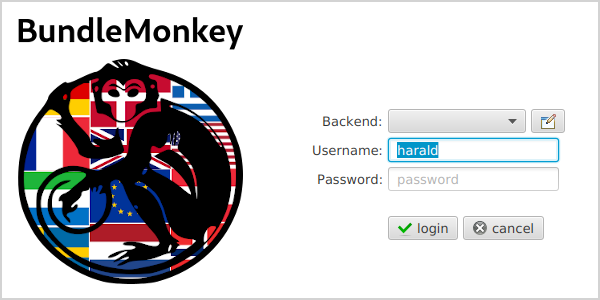
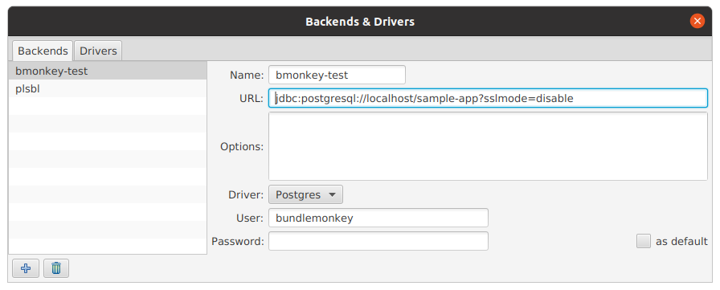

# BundleMonkey — The Live Translation Editor

**BundleMonkey** is a standalone JavaFX desktop tool for editing the
[database-backed resource bundles](i18n.md) of a Tentackle application. It connects directly
to an application's database and lets translators view, add and change translations at runtime —
the edits take effect immediately in every running client and server, without rebuilding or
redeploying anything.

BundleMonkey is the interactive counterpart to the build-time
[`tentackle-i18n-maven-plugin`](../../../tentackle-i18n-maven-plugin/src/main/docs/tentackle-i18n-maven-plugin.md):
the plugin's `push` goal seeds the database from the application's property files, and from then on
translators do their day-to-day work in BundleMonkey while developers occasionally `pull` the
results back into the sources.

## Who It Is For

- **Translators and localization staff** — non-developers who are responsible for one or more
  locales. They edit texts through the GUI, without touching source code, an IDE or a build. Each
  translator can enable just the locales they own and ignore the rest.
- **Developers and deployers** — who use it to spot missing translations before a release, to add
  languages that are *not* shipped in the application's property files at all, and to perform bundle
  refactorings (rename/remove keys, drop obsolete bundles) directly against the database.

Because the texts live in the database rather than the jars, translators can maintain **any number
of additional locales** beyond the ones the developers ship — the developers are relieved from
carrying those translations in the application's resources.

## How It Fits the i18n Workflow

BundleMonkey operates on the same *stored bundles* described in
[Tentackle I18N](i18n.md). It is the editing stage of a cycle whose other stages are Maven goals of
the [i18n plugin](../../../tentackle-i18n-maven-plugin/src/main/docs/tentackle-i18n-maven-plugin.md):

| Stage       | Performed by                    | Purpose                                                              |
|-------------|---------------------------------|---------------------------------------------------------------------|
| **push**    | `mvn tentackle-i18n:push`       | Seed the database from the property files (adds new keys only; never overwrites translator edits). |
| **edit**    | **BundleMonkey**                | Translators maintain the stored texts and extra locales at runtime. |
| **pull**    | `mvn tentackle-i18n:pull`       | Copy edits back into the property files so they enter the VCS changelog (shipped locales only). |
| **verify**  | `mvn tentackle-i18n:verify`     | Ensure no stored bundle is missing keys before deployment (guards against `MissingResourceException`). |
| **cleanup** | `mvn tentackle-i18n:cleanup`    | Remove obsolete bundles/translations; also reachable from BundleMonkey's context menu. |

## Obtaining It

BundleMonkey is developed as a **separate open-source project** at
[bitbucket.org/krake-oss/bundlemonkey](https://bitbucket.org/krake-oss/bundlemonkey). It is an
application, not a library or a Maven plugin, so it is **not published to Maven Central**.

It is distributed as a self-contained, platform-specific
[jlink](../../../tentackle-jlink-maven-plugin/src/main/docs/jlinkpackage.md) image that bundles its
own Java runtime — nothing else needs to be installed.

To build the image yourself, clone the repository and run `mvn clean install -Prelease,jlink`; the
ZIP is produced under `jlink/target/`.

Start it from the `bin` folder via `bundlemonkey.sh` (Linux/macOS) or `bundlemonkey.cmd` (Windows).

## Connecting to a Database

At startup, BundleMonkey shows a login window. Press **edit backends** to configure the database
drivers and connections the first time.

BundleMonkey needs read/write access to only four Tentackle database objects:

- `modification`
- `bundle`
- `bundlekey`
- `object_sequence_id`

It is recommended to create dedicated database users for BundleMonkey whose privileges are
**restricted to those objects only**.

## Using the Main View

The main view is a two-pane editor: a tree table of bundles on the left, and the per-locale
translations of the selected key on the right.

- **Locale radio buttons** across the top enable only the locales a translator is responsible for.
  The selection is remembered in the preferences and applies to every application maintained with
  this installation.
- **Filter** (bottom left) narrows the navigation tree. Press **F2** to jump to the field / apply
  the filter, **Shift-F2** to clear it. A leading `!` or `-` negates the filter.
- **Find** searches the bundles. Press **F3** to jump to the field / start searching and again to
  move to the next match; **Shift-F3** moves to the previous match; a leading `!` or `-` negates the
  search. Filtering and searching are case-insensitive by default, toggled by the **Cc** button next
  to the field.
- **Row colors** flag state at a glance: a **blue** background marks a *modified* entry, a
  **yellow** background a *missing* one. The **Notes** column spells out the details
  (e.g. *"1 modified, 1 missing, 15 translated"*).
- The tree table's **context menu** offers refactoring operations, including the cleanup of obsolete
  bundles and translations.

Changes are held in memory and written to the database only when the **save** button is pressed.
Beyond this, all the usual conveniences of a Tentackle FX rich-client application apply.

## Jumping Straight from the Application to a Translation

BundleMonkey can synchronize its view to the exact text you are looking at in a *running* Tentackle
FX application. While both the application and BundleMonkey are open on the same machine, point at any
component in the application and press **Ctrl + Shift + right-mouse-button**: BundleMonkey navigates
its tree to the bundle and key that supply that component's text, ready for editing. This spares the
translator from hunting for the right bundle by hand.

The gesture is handled by every Tentackle FX window through
[`FxUtilities.registerWindowEventFilters`](../../../../tentackle-fx/src/main/java/org/tentackle/fx/FxUtilities.java):
it picks the node under the cursor, dumps its component hierarchy (which carries the resource-bundle
name of the text) and sends that dump to BundleMonkey over a Unix domain socket named `.bmonkey.sock`
in the user's home directory (see
[`BundleMonkeyHelper`](../../../../tentackle-fx/src/main/java/org/tentackle/fx/BundleMonkeyHelper.java)).
BundleMonkey only receives the message when it is already running and listening on that socket; if it
is not, the gesture is simply a no-op in the application.

## See Also

- [Tentackle I18N — Database-backed Resource Bundles](i18n.md) — the runtime module BundleMonkey
  edits, and how stored bundles transparently override the property files.
- [I18N Maven Plugin](../../../tentackle-i18n-maven-plugin/src/main/docs/tentackle-i18n-maven-plugin.md) —
  the `push`/`pull`/`verify`/`cleanup` goals that complete the workflow.
- [Check Maven Plugin](../../../tentackle-check-maven-plugin/src/main/docs/tentackle-check-maven-plugin.md) —
  build-time verification that bundle keys referenced in the sources actually resolve.
