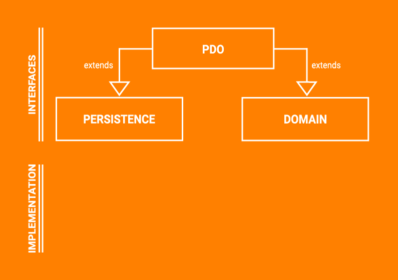

# MyApp — A Guided Walkthrough of a Generated Tentackle Application

This document walks, end to end, through the example application produced by
[`tentackle-project-archetype`](tentackle-project-archetype.md). It is written for a developer who is **new to
Tentackle** and wants to understand how a real, runnable Tentackle application is laid out, how its layers fit
together, and where to look when adding features of their own.

The companion document [`tentackle-project-archetype.md`](tentackle-project-archetype.md) explains the *archetype*
(the Velocity templates and how generation works). This document instead treats the **generated project as a
reference application** and reads it like production code.

> The walkthrough follows the project generated with
> `-DartifactId=myapp -Dpackage=com.example.myapp -Dapplication=MyApp`, i.e., the one the archetype's own
> integration test materializes under
> `tentackle-project-archetype/target/test-classes/projects/myapp/project/myapp`. Throughout, file paths are given
> relative to that generated project root (e.g. `myapp-pdo/src/main/java/com/example/myapp/pdo/md/User.java`).

---

## 1. What the application *is*

MyApp is a small but complete multi-tier business application. Out of the box it gives you:

- a domain of **Users**, **User Groups**, a **User↔Group** N:M link, an **Organizational Unit** base entity, and a
  **Message** log;
- a **JavaFX desktop client** with login, CRUD editors, search/finders, preferences, theming, an about box, an
  auto-updater, and a security-administration UI;
- a **middle-tier server** speaking [TRIP](../../../../tentackle-core/src/main/docs/trip.md) (Tentackle's
  RMI/JOS replacement) that also hosts the software auto-update service;
- a headless **console daemon** that listens for new `Message`s and logs them;
- **jlink/jpackage** packaging for all three runnables;
- full **JPMS** module declarations, **i18n** in English and German, role-based **security**, and a **TestNG** test
  suite running against an in-memory H2 database.

It demonstrates the framework's central idea — the **Persistent Domain Object (PDO)** — together with the code
generation, remoting, UI, and build machinery that surround it.

---

## 2. The module map

MyApp is a Maven reactor of eight library/application modules plus a `jlink` sub-aggregator. The root
`pom.xml` is a `pom`-packaging aggregator that imports
[`tentackle-bom`](../../../../tentackle-bom/src/main/docs/bom.md) and centralizes **all** plugin configuration in
`<pluginManagement>` so the child modules stay tiny.

```
myapp (root pom — aggregator + pluginManagement + model defaults)
├── myapp-common        cross-cutting types: Constants, Version, SessionInfo, DomainContext, Cryptor, Locale, Preferences
├── myapp-pdo           PDO *interfaces* (entity + domain facet + persistence facet) + the embedded model + security + enums
├── myapp-domain        domain-logic *implementations*            (open module)
├── myapp-persistence   persistence *implementations* + TRIP remote delegates  (open module)
├── myapp-gui           JavaFX RDC controllers, editors, finders, FXML/CSS, images  (open module)
├── myapp-client        the desktop FX client application
├── myapp-server        the middle-tier TRIP server + update service
├── myapp-daemon        the headless console client
└── jlink               jlink/jpackage images (only built under the "jlink" profile)
    ├── client
    ├── server
    └── daemon
```

### Layering and JPMS

Every module has an explicit `module-info.java`. The dependency edges encode Tentackle's architecture and, crucially,
**keep the persistence and domain layers from knowing about each other** — they only share the PDO *interfaces*.

| Module     | key `requires`                                                                     | `open`? | Role                                                                                                                                             |
|------------|------------------------------------------------------------------------------------|:-------:|--------------------------------------------------------------------------------------------------------------------------------------------------|
| `…common`  | `transitive org.tentackle.pdo`                                                     |   no    | base types shared by everything                                                                                                                  |
| `…pdo`     | `transitive …common`                                                               |   no    | the PDO **interfaces** that define the model; exports `…pdo`, `…pdo.md`, `…pdo.td`, the `.domain`/`.persist` facet packages, and `…pdo.security` |
| `…domain`  | `transitive …pdo`, `transitive org.tentackle.domain`                               | **yes** | domain-logic implementations (`UserDomainImpl`, `MessageDomainImpl`, …)                                                                          |
| `…persist` | `transitive …pdo`, `transitive org.tentackle.persistence`                          | **yes** | persistence implementations + TRIP remote delegates                                                                                              |
| `…gui`     | `transitive …pdo`, `transitive org.tentackle.fx.rdc`, `org.tentackle.fx.atlanta`   | **yes** | FX controllers, editors, providers, FXML/CSS                                                                                                     |
| `…client`  | `transitive …gui`, `…persist`, `…domain`, `transitive org.tentackle.fx.rdc.update` |   no    | the desktop application                                                                                                                          |
| `…server`  | `transitive …persist`, `…domain`, `transitive org.tentackle.update`                |   no    | the middle-tier server                                                                                                                           |
| `…daemon`  | `transitive …persist`, `…domain`                                                   |   no    | a headless console client                                                                                                                        |

The domain, persistence, and gui modules are **`open module`** because the framework reflects into them: TRIP
serializes PDO state, JavaFX/FXML instantiates controllers, and the proxy-based PDO assembly (below) needs reflective
access to the implementation classes.

Notice that `…client`, `…server` and `…daemon` each pull in **both** `…persist` and `…domain`. A running JVM needs both
implementation layers; only the *compile-time* code in `…pdo` is shared, and neither implementation module requires the
other. See [Common / Services & Configuration](../../../../tentackle-common/src/main/docs/common.md) and
[the modules overview](../../../../src/main/docs/modules.md) for the framework-level rationale.

### The module-hook SPI

Every module declares

```java
provides org.tentackle.common.ModuleHook with com.example.myapp.<module>.service.Hook;
```

`service/Hook.java` is a minimal class implementing `ModuleHook` (it forwards `getBundle(...)` to
`ResourceBundle.getBundle`). This is the SPI entry point through which the framework's
[`ServiceFinder`](../../../../tentackle-common/src/main/docs/services.md) discovers and initializes each module —
the mechanism that lets the same code run **modular or non-modular** without change. When you add a module, copy this
one-class pattern.

---

## 3. The heart of it: the PDO pattern

> Read alongside [PDO — Persistent Domain Objects](../../../../tentackle-pdo/src/main/docs/pdo.md) and
> [PDO vs. ORM](../../../../tentackle-pdo/src/main/docs/pdo-vs-orm.md).

A **PDO** is a single logical entity that Java cannot express directly because it needs *two* independent
implementation inheritance chains — one for persistence, one for domain logic. Tentackle emulates that multiple
inheritance with a **dynamic proxy** that fronts a `PersistentObject` and a `DomainObject` working in tandem.




For each entity there are (at least) five Java types, plus generated SQL. Take **`Message`**:

| Artifact                    | File                                                                |             Hand-written?             |
|-----------------------------|---------------------------------------------------------------------|:-------------------------------------:|
| **PDO interface**           | `myapp-pdo/.../pdo/td/Message.java`                                 |     yes — and carries the *model*     |
| **Persistence facet**       | `myapp-pdo/.../pdo/td/persist/MessagePersistence.java`              | partly — generated accessors woven in |
| **Domain facet**            | `myapp-pdo/.../pdo/td/domain/MessageDomain.java`                    |     yes — extra business methods      |
| **Persistence impl**        | `myapp-persistence/.../persist/td/MessagePersistenceImpl.java`      |        yes + generated regions        |
| **Domain impl**             | `myapp-domain/.../domain/td/MessageDomainImpl.java`                 |                  yes                  |
| **Remote delegate (+impl)** | `myapp-persistence/.../persist/td/trip/MessageRemoteDelegate*.java` |               generated               |
| **SQL/DDL & mapping**       | under `target/wurbel/model`                                         |               generated               |

The PDO interface is where you, the developer, *live*. It extends its persistence facet, its domain facet, and a shared
base interface:

```java
public interface Message extends TransactionData<Message>, MessagePersistence, MessageDomain {
  ...
}
```

- `MessagePersistence` (extends `PersistentObject<Message>`) gives you generated typed getters/setters
  (`getMessageNumber()`, `setText(...)`, relation accessors) plus hand-declared persistence operations like
  `nextMessageNumber()` and `findBy(...)`.
- `MessageDomain` (extends `DomainObject`) declares business operations: `create(...)`, `getRefersToPdo()`,
  `getFormattedRefersTo()`, `toDiagnosticString()`.
- `TransactionData<T>` / `MasterData<T>` (in `myapp-pdo`) are thin project-wide marker bases extending
  `PersistentDomainObject<T>`. They let you attach behavior or constraints to whole *categories* of entity. The split
  mirrors the two **wizard profiles** (`masterdata`, class ids ≥ 1000; `transactiondata`, class ids ≥ 2000).

### How an instance is assembled

You never call a constructor. You ask the factory:

```java
Message m = Pdo.create(Message.class, context);   // a live, empty PDO bound to a domain context
```

or if inside a `DomainContextProvider` (which is usually the case):

```java
Message m = on(Message.class);
```

`Pdo.create` or `on(...)` returns a proxy implementing `Message`. Calls that belong to the persistence facet are routed to a
`MessagePersistenceImpl`; calls on the domain facet go to a `MessageDomainImpl`. Inside an implementation, `me()`
returns the proxy (so a domain method can call persistence methods and vice-versa) and `getDomainContext()` yields the
ambient context. You can see both halves cooperating in `MessageDomainImpl.create(...)`:

```java
me().setMessageType(messageType);
…
me().setOrgUnit(owner);
me().setWhen(new Timestamp());
me().setMessageNumber(me().nextMessageNumber());   // persistence facet
return me().persist();                              // write through
```

The implementations are wired to their PDO class by annotations the framework discovers via the service SPI:
`@PersistentObjectService(Message.class)` on `MessagePersistenceImpl` and `@DomainObjectService(Message.class)` on
`MessageDomainImpl`.

### Aggregates are first-class

`User` and `UserGroup` both `extends OrgUnit`, which uses **multi-table inheritance** (`inheritance := multi` in the
model). `User2Group` is the N:M link, and `User`/`UserGroup` each expose it as a **component list** (`relation =
component list`). Because Tentackle models aggregates explicitly, a component always knows its root without a query and
DDD invariants are enforced by the persistence layer. See the `User.java` model block in §4 and the
[persistence](../../../../tentackle-persistence/src/main/docs/persistence.md) docs.

### Remoting is transparent

Because the persistence layer is remoting-capable, **every PDO method works in any JVM** — directly connected to the
database (server) or remote over TRIP (client, daemon). There is no `LazyInitializationException` in Tentackle: a
relation accessor simply executes wherever it must. The `…RemoteDelegate` classes under each `trip` package are the
generated plumbing that carries method calls across the wire. This is why all three runnables can share the identical
contract:

```java
@Override public User getUser(DomainContext context, long userId) {
  return Pdo.create(User.class, context).selectCached(userId);
}
```

---

## 4. The embedded model — reading the entity comment blocks

> Reference: [Model definition](../../../../tentackle-model/src/main/docs/model-definition.md) and the
> [persistence wurblets](../../../../tentackle-persistence-wurblets/src/main/docs/persistence-wurblets.md).

The **model is authored in special comment blocks inside the PDO interface**, and code generation reads it from there.
There are two kinds of block, both visible at the top of `OrgUnit.java`:

```java
/*
 * @{                                  <-- a "definitions" block: local variables for this file
 * tablename = md.orgunit
 * mapping   = $model/$tablename.map
 * @}
 */

/*
 * @> $mapping                          <-- a "wurble into file $mapping" block: the actual model
 *
 * # Organizational Unit
 * name := $classname
 * table := $tablename
 * inheritance := multi
 * integrity := $integrity
 *
 * ## attributes
 * [cached, tokenlock | +name]
 * String($ou_name)    name      name      short name [key, uc, normtext]
 * String($ou_comment) comment   ocomment  optional comment [normtext]
 *
 * ## indexes
 * unique index udk := name
 *
 * ## relations
 *
 * ## validations
 * name: @NotNull(message="{ @('please enter the name') }")
 * @<
 */
```

Things to note for a newcomer:

- **`attributes`** are declared as `JavaType(size) attributeName column_name description [modifiers]`. Modifiers in
  brackets drive generation: `key` (part of the domain key), `uc`/`normtext` (uppercase / normalized search text),
  `cached`, `tableserial`, `trimwrite`, `@NotNull` (a constraint of Tentackle's
  [validation layer](../../../../tentackle-core/src/main/docs/validation.md)), `[MUTE]` (excluded from the PDO —
  see the password below), etc.
- **`validations`** attach further [validation annotations](../../../../tentackle-core/src/main/docs/validation.md)
  to attributes; the `{ @('please enter the name') }` syntax pulls the localized message from the module's resource
  bundle, so validation failures speak the user's language.
- **`$ou_name`, `$ou_comment`, `$msg_text`…** are *column sizes* defined centrally in the root `pom.xml`
  (`<wurbletProperties>`), so the whole model's field widths are tuned in one place.
- **`extends := OrgUnit`** in `User.java`/`UserGroup.java` produces the multi-table inheritance.
- **`relations`** declare aggregation. `User`'s block declares the component list `nmLinks` over `User2Group` with the
  N:M shortcut `nm = UserGroup UserGroups`, which is what gives `User.getUserGroups()`.
- **`@ClassId`** assigns a stable numeric class id (`1001` User, `1002` UserGroup, `1003` User2Group, `2001` Message).
  Class ids are how PDOs are identified across the wire and in the `Message.refersToClassId` polymorphic reference.

A subtle, instructive detail: `User`'s `password` attribute is declared `[MUTE]`, so the hash column exists in the
table but is **not** part of the `User` PDO. The hash is read/written only through dedicated persistence operations
(`selectPasswordHash()`, `updatePasswordHash(...)`), keeping it off the wire — see the login flow in §9.

`@TableName(...)` and `@ClassId(...)` carry `/*@*/ … /*@*/` markers; the `Inject` wurblet keeps those literals in sync
with the model variables. The `// @wurblet …` comments are **guarded regions** — read on.

### What the generator makes of it: the model comment

The model block above is your *input*. To see what the tooling *understands* from it, look just inside the interface
body, where the `modelComment ModelComment` wurblet weaves a read-only summary of the entity's place in the model. In
`OrgUnit.java` it expands to:

```java
public interface OrgUnit<T extends OrgUnit<T>> extends MasterData<T>, OrgUnitPersistence<T>, OrgUnitDomain<T> {

  // @wurblet(fold=expanded) modelComment ModelComment

  //<editor-fold defaultstate="expanded" desc="code 'modelComment' generated by wurblet ModelComment">//GEN-BEGIN:modelComment

  /*
   * -----------------------------------------------------------------------------------------------------------------
   *
   * OrgUnit is referenced by:
   *
   * Message via orgUnitId as orgUnit [1:1]
   *
   *
   * OrgUnit is a root entity
   *
   *
   * OrgUnit is not referencing other entities
   *
   *
   * Components of OrgUnit are not deeply referenced
   *
   *
   * OrgUnit is extended by:
   *    ^ User
   *    ^ UserGroup
   *
   * -----------------------------------------------------------------------------------------------------------------
   */

  //</editor-fold>//GEN-END:modelComment
```

This block is **generated**, not authored: the Wurbelizer resolves the *whole* model — including relations declared in
*other* files — and reflects each entity's incoming references, root/aggregate status, outgoing references, and
inheritance back into its own source. Here it tells you, at a glance, that `OrgUnit` is referenced by `Message`'s
`orgUnit`, is an aggregate root referenced by nothing further, references nothing itself, and is the multi-table base
of `User` and `UserGroup` (the `^` arrows). Because it lives right where you read the code, it keeps the model's
cross-file structure visible without chasing it through the other PDO sources — and it is your first concrete sight of a
**guarded region**, the mechanism the next section is about.

---

## 5. Code generation: wurblets and guarded regions

> Reference: [Wurblets](../../../../tentackle-wurblets/src/main/docs/wurblets.md),
> [persistence wurblets](../../../../tentackle-persistence-wurblets/src/main/docs/persistence-wurblets.md),
> [pdo-select](../../../../tentackle-persistence-wurblets/src/main/docs/pdo-select.md).

Tentackle does not generate code into separate files you must not touch. Instead it **weaves generated code into
guarded regions inside your own source files**. A guard looks like a comment marker; the
[Wurbelizer](https://www.wurbelizer.org/) replaces the region's body on each build, while leaving your hand-written
code between regions untouched. In `MessagePersistenceImpl.java` you can see the seams:

```java
// @wurblet classVariables ClassVariables
// @wurblet columnNames ColumnNames
// @wurblet declare Declare
…
// @wurblet methods MethodsImpl
// @wurblet relations PdoRelations
```

Each `// @wurblet <name> <Wurblet>` invokes a named generator. So `MessagePersistence` (the facet interface) gets its
typed `getXxx/setXxx` and `AN_*`/`CN_*` constant names from `AttributeNames`/`Methods`/`ColumnLengths` wurblets, while
`MessagePersistenceImpl` gets the JDBC column plumbing — and you fill in the rest (`nextMessageNumber()`, `findBy(...)`)
by hand, using framework helpers like `Query`, `NormText` and `NumberSourceFactory`.

The generators are selected per file-type by the `<filesets>` in the root `pom.xml`'s
`wurbelizer-maven-plugin` configuration: entity interfaces, facet interfaces, implementations, and `trip` delegates each
get their appropriate wurblets. The build order that makes this work is:

1. **tentackle-maven-plugin** `analyze`/`test-analyze` — emit service descriptors and analysis metadata.
2. **wurbelizer-maven-plugin** `wurbel`/`test-wurbel` — run the wurblets, weave the guarded regions, and emit the model
   under `target/wurbel/model`.
3. **tentackle-sql-maven-plugin** — turn the model into DDL for the `td` and `md` schemas (with migration hints).
4. **tentackle-check-maven-plugin** `bundles`/`validations` — verify i18n completeness (`en_US, de_DE`) and Groovy
   validation scripts.
5. **tentackle-i18n-maven-plugin** — i18n resource handling.
6. **maven-compiler-plugin** — compile with the framework annotation processors
   (`tentackle-core`, `tentackle-pdo`, `tentackle-fx`, `tentackle-fx-rdc`) on the processor path.
7. **tentackle-jlink-maven-plugin** — build native images under the `jlink` profile.

The same pipeline, with each step's own document, is summarized in
[`tentackle-project-archetype.md` §"The Generated Build Pipeline"](tentackle-project-archetype.md).

---

## 6. The `common` module — cross-cutting plumbing

`myapp-common` holds the small classes every layer needs. Most are **thin subclasses of framework defaults registered
as services** (`@Service(...)`), so the framework picks them up automatically:

| Class                       | Extends / implements             | Why it exists                                                                     |
|-----------------------------|----------------------------------|-----------------------------------------------------------------------------------|
| `MyAppSessionInfo`          | `DefaultSessionInfo`             | login credentials + connection params; here it forces usernames to **uppercase**  |
| `MyAppSessionInfoFactory`   | `@Service(SessionInfoFactory)`   | builds `MyAppSessionInfo` from username/password/properties                       |
| `MyAppDomainContext`        | `DefaultDomainContext`           | the per-call context; narrows `getSessionInfo()` to `MyAppSessionInfo`            |
| `MyAppDomainContextFactory` | `@Service(DomainContextFactory)` | builds `MyAppDomainContext`                                                       |
| `MyAppCryptor`              | `@Service(Cryptor.class)`        | app-specific symmetric encryption (salt + passphrase) for stored secrets — see [Cryptor and EncryptedProperties](../../../../tentackle-common/src/main/docs/cryptor.md) |
| `MyAppLocaleProvider`       | `@Service(LocaleProvider.class)` | restricts supported locales to `en` (default) and `de`                            |
| `MyAppPreferences`          | —                                | typed access to persisted system/user [preferences](../../../../tentackle-core/src/main/docs/preferences.md) (e.g. the help URL) |
| `Version`                   | —                                | reads `version`/`date` from a *filtered* `Version.properties` baked at build time |
| `Constants`                 | —                                | app constants such as the realm `"MyApp"` of the [number pool](../../../../tentackle-pdo/src/main/docs/ns.md) |

The **`SessionInfo` / `DomainContext`** pair is worth internalizing early:

- A **`SessionInfo`** describes *who is connecting and how* (user, password, backend properties). `MyAppSessionInfo`
  uppercases usernames because the model declares the `OrgUnit.name` key as `uc` — the two must agree.
- A **`DomainContext`** is the ambient handle threaded through every PDO call: it carries the `Session` (database or
  remote connection) and is what you pass to `Pdo.create(Clazz.class, context)`. The FX controllers obtain it via
  `Application.getInstance().getDomainContext()` (see `MainController.getDomainContext()`).

`MyAppCryptor` deliberately obfuscates its salt/passphrase character-by-character and notes in comments that production
deployments should derive the passphrase from an external source. It is the same `Cryptor` the build uses to encrypt
passwords into the jlink images (§14) — the full mechanism, including the `~`-prefixed encrypted values in properties
files, is described in [cryptor.md](../../../../tentackle-common/src/main/docs/cryptor.md).

---

## 7. Security — users, groups, and permissions

> Reference: [Security](../../../../tentackle-pdo/src/main/docs/security.md).

Security lives in `myapp-pdo/.../pdo/security`:

- `MyAppSecurityFactory` (`@Service(SecurityFactory.class)`) plugs in
- `MyAppSecurityManager extends DefaultSecurityManager`, which implements the **user→group role expansion**.

When the framework needs to decide whether a grantee (the logged-in user) may do something,
`determineGranteesToCheck(...)` returns the user **plus every `UserGroup` they belong to plus the “all” grantee
`(0,0)`**. Permissions granted to a group therefore apply to all its members. Two details show real-world care:

- The manager listens with `Pdo.listen(this::invalidate, User.class, UserGroup.class)` and rebuilds itself whenever a
  user or group changes — so permission changes take effect live.
- `evaluateImpl(...)` short-circuits **read** permission on `User`/`UserGroup`/`User2Group` to “accepted”, which
  prevents an infinite recursion: expanding a user's groups must itself read users and groups.

The FX `MainController` consults this in `configure()` to enable/disable the *Security Manager*, *Sessions* and
*Preferences* menu items based on the current user's permissions, and the editors gate actions on
`pdo.isEditAllowed()`, `isViewAllowed()`, etc.

---

## 8. The three runnable applications

All three subclass a Tentackle **application base class** and share the `getUser(...)` contract from §3. Each `main`
just constructs the application and calls `start(args)`; the base class drives configuration, login, the session
lifecycle and shutdown hooks. The startup sequence (`register → initialize → login → configure → finishStartup`)
and the three application shapes — console, server, desktop — are dissected in
[Application Bootstrap](../../../../tentackle-pdo/src/main/docs/application.md).

### 8.1 Desktop client — `MyAppFxClient`

`myapp-client/.../client/MyAppFxClient.java` extends `UpdatableDesktopApplication<MainController>`. It declares:

- `getApplicationClass()` → `MyAppLoginApplication` (the JavaFX `Application` that shows the login dialog, with
  app-specific `Login.css` / `Login-dark.css` and a 30-second inactivity timeout);
- `getMainControllerClass()` → `MainController`;
- `configureMainStage(...)` to set the window title and route the window-close button through `MainController.exit()`
  (which asks for confirmation);
- `configurePreferences()` to apply the logged-in user's preference policy (`setSystemOnly`, `setReadOnly`) and react to
  live changes of the help URL.

Being an **`Updatable…`** application, it wires in the
[auto-updater](../../../../tentackle-update/src/main/docs/update.md) (`org.tentackle.fx.rdc.update`), which checks the
server's update service on startup.

`MainController` (`myapp-gui`) is the menu-driven shell: it opens CRUD editors via
`Rdc.displayCrudStage(on(clazz), …)`, search dialogs via `Rdc.displaySearchStage(...)`, the preferences dialog, theme
switcher, password change, the security-administration dialog, and a server-sessions view. `on(clazz)` is the controller
helper that creates a PDO bound to the controller's domain context.

### 8.2 Middle-tier server — `MyAppServer`

`myapp-server/.../server/MyAppServer.java` extends `ServerApplication`. Its constructor names the service
(`"MyAppServer"`), passes the build `Version.RELEASE`, and registers `MyAppRemoteDbConnectionImpl` as the connection
class. After the base startup it calls `createUpdateService()`, which — if `updateService`/`updateURL` properties are
set — starts the [server-side update service](../../../../tentackle-update/src/main/docs/update.md) so clients can
auto-update to the running version.

The server is the only tier **directly** connected to the database; clients and the daemon connect *to the server* over
TRIP. This is the classic three-tier topology, and it is configured purely through properties (§12), not code —
see the [Multi-Tier Cascade](../../../../src/main/docs/tiers.md) for the deeper cascades the same mechanism allows.

### 8.3 Console daemon — `MyAppDaemon`

`myapp-daemon/.../daemon/MyAppDaemon.java` extends `ConsoleApplication`. It is the smallest end-to-end example of
**event-driven** Tentackle code:

```java
latestMessageId = on(Message.class).selectMaxId();
Pdo.listen(this::logMessages, Message.class);   // fire whenever a Message is committed anywhere
```

`Pdo.listen(...)` is the framework's change-notification primitive (the same one the security manager uses, and the
one that keeps the [PDO cache](../../../../tentackle-pdo/src/main/docs/cache.md) coherent across tiers). Whenever a
`Message` is persisted — by *any* JVM connected to the server — every listener is notified, and the daemon prints the
new messages. It illustrates that PDO change events, like PDO methods, cross the remoting boundary transparently.

---

## 9. Remoting and the login lifecycle (TRIP)

> Reference: [TRIP](../../../../tentackle-core/src/main/docs/trip.md),
> [session](../../../../tentackle-session/src/main/docs/session.md).

The `trip` packages contain the connection/session classes that make remoting concrete:

- `myapp-pdo/.../pdo/MyAppRemoteSession` — a marker interface for the app's remote session type.
- `myapp-persistence/.../persist/trip/MyAppConnection`, `MyAppRemoteSession`, `MyAppRemoteSessionAdapter`,
  `MyAppRemoteSessionFactory` — the client-side remote-session machinery.
- `myapp-server/.../server/trip/MyAppRemoteDbConnectionImpl` and `MyAppRemoteDbSessionImpl` — the **server-side**
  endpoint.

Together with `myapp-server/.../server/auth/MyAppPasswordAuthenticationProvider` they are where the application's
authentication happens — split along the line between *verifying credentials* and *managing a session*
(see [Authentication](../../../../tentackle-session/src/main/docs/authentication.md)):

- `MyAppRemoteDbConnectionImpl.checkClientVersion(...)` rejects clients whose `Version.RELEASE` differs from the
  server's — version skew is caught at connect time (`VersionIncompatibleException`).
- `MyAppPasswordAuthenticationProvider` is a `@Service(AuthenticationProvider.class)` and does the **credential
  check**: it looks up the `User` by unique domain key (the uppercase username), compares `user.hash(password)`
  against `user.selectPasswordHash()` (recall the hash is `[MUTE]`d out of the PDO and fetched on demand), enforces
  `isLoginAllowed()`, and returns the proven identity with the user's id. Adding single sign-on means adding a
  second provider next to it, not editing this one.
- `MyAppRemoteDbSessionImpl.verifySessionInfo(...)` calls `super` — which runs that provider chain — and then adds
  what belongs to the **session**: it sets the locale, rejects duplicate logins of the same main session
  (`AlreadyLoggedInException`), and **logs a `LOGIN` message**.
- `closeDb(...)` mirrors that on logout / crash, writing a `LOGOUT` message (annotated as `crashed …` if the session
  died). This is the producer side of the events the daemon listens for in §8.3.

Notice how login/logout auditing reuses the very same `Message.log(...)` PDO that the rest of the app uses — the
framework's pieces compose.

---

## 10. The GUI / RDC layer

> Reference: [FX RDC](../../../../tentackle-fx-rdc/src/main/docs/rdc.md) and
> [tentackle-fx](../../../../tentackle-fx/src/main/docs/fx.md).

The desktop UI is built with **RDC (Rich Desktop Client)**. For each entity the `myapp-gui` module follows a small,
repeatable trio of artifacts (look at the `user`, `usergroup` and `message` sub-packages):

1. A **`…GuiProvider`** annotated `@GuiProviderService(Entity.class)` — the framework's per-entity UI service. It says
   what graphic to show, whether an editor/finder exists, how to build them, how the entity appears in trees, and how
   drag-and-drop behaves. `UserGuiProvider`, for instance, accepts dropped `UserGroup`s and adds them to the user.
2. A **`…Editor`** extending `PdoEditor<Entity>` annotated `@FxControllerService`, paired with an **`.fxml`** layout and
   **`.properties`** bundles co-located in `src/main/java` (a Tentackle convention so SceneBuilder finds them by
   relative path, the project's FXML/FX convention). Fields are wired with `@FXML` and bound to the PDO with
   `@Bindable` + the controller's binder (see the [binding API](../../../../tentackle-core/src/main/docs/binding.md)).
   `UserEditor` shows a text field, checkboxes, a child `UserGroup` table with a
   context menu, and a password button.
3. A **`…Finder`** (e.g. `MessageFinder`) or the framework's `DefaultPdoFinder`, plus a `TableConfiguration` describing
   the search-result columns (see `MessageGuiProvider.createTableConfiguration()`, which uses the generated `AN_*`/`RN_*`
   attribute-name constants for column ids and bundle keys — the configuration-driven table machinery is covered in
   [Tables and Trees](../../../../tentackle-fx/src/main/docs/tables.md)).

`MainController` ties it together: menu items call `edit(clazz)` / `search(clazz)`, which delegate to
`Rdc.displayCrudStage(...)` / `Rdc.displaySearchStage(...)`; the RDC layer then looks up the right `GuiProvider`,
builds the editor or finder, and manages the stage. Theming (light/dark via `org.tentackle.fx.atlanta`), the about box,
preferences dialog, and password-change view round out the shell.

---

## 11. Internationalization

> Reference: [i18n](../../../../tentackle-i18n/src/main/docs/i18n.md),
> [bundles](../../../../tentackle-common/src/main/docs/bundle.md),
> [internationalization](../../../../tentackle-common/src/main/docs/internationalization.md).

Every module that emits user-facing text ships a `*Bundle.java` accessor and `*Bundle.properties` /
`*Bundle_de.properties` pairs (`PdoBundle`, `DomainBundle`, `PersistenceBundle`, `ServerBundle`, `GuiBundle`, plus the
per-view `.properties`). The `MessageType` enum even localizes itself via `PdoBundle.getString(name())`.

Completeness is **enforced at build time**: the `tentackle-check-maven-plugin` `bundles` goal checks that the
`en_US, de_DE` locales are in sync, and the i18n plugin handles the resources. `MyAppLocaleProvider` narrows the
runtime to those two languages with English as fallback. The classes deliberately avoid stray string constants that
would trip the i18n checker (see the comment in `Version.java`).

---

## 12. Configuration and properties

The runnables are configured by **`.properties` files resolved as resources**, selected with a `--backend=<name>`
(client/daemon) or `--backend`/service argument (server) — how the command line is parsed into a `SessionInfo` is
part of the [application startup sequence](../../../../tentackle-pdo/src/main/docs/application.md). Two patterns
appear:

- **`backend.properties`** (client/daemon) points the JVM at a data source. In the *test* resources the client uses
  `url=${dbService}` (a `trip://…` server URL) and the daemon an H2 in-memory URL; the *packaged images* get their
  own filtered `backend.properties` (under `jlink/*/src/main/filtered-resources`) — the client connects to the TRIP
  service, the daemon additionally carries its fixed `daemon` account. Commented lines show optional
  auto-login / view-only setups.
- **`server.properties`** gives the server its JDBC `url`/`user`/`password`, the TRIP `service` URL to publish, and a
  `timeout`.

The `${…}` placeholders are **Maven-filtered** at build time from properties defined in the root `pom.xml`
(`dbUrl`, `dbUser`, `dbPasswd`, `dbService`, `updateService`, `updateURL`). Filtered resources live under
`src/(main|test)/filtered-resources`; verbatim ones under `src/(main|test)/resources`. This split is configured once in
the root POM's `<resources>`/`<testResources>` and inherited everywhere.

Secrets are never stored in clear text in the packaged images: the jlink build encrypts them with `MyAppCryptor`
(see §14 and [cryptor.md](../../../../tentackle-common/src/main/docs/cryptor.md)).

---

## 13. Testing

> Reference: [tentackle-test-pdo](../../../../tentackle-test-pdo/src/main/docs/tentackle-test-pdo.md) (the TestNG
> base classes used here), [tentackle-test-fx-rdc](../../../../tentackle-test-fx-rdc/src/main/docs/tentackle-test-fx-rdc.md)
> (UI testing), and [persistence](../../../../tentackle-persistence/src/main/docs/persistence.md).

The project demonstrates three distinct testing styles:

- **Pure domain unit test, no database** — `myapp-domain/.../domain/td/MessageTest.java`. `Pdo.create(Message.class)`
  with *no context* gives a PDO backed by a persistence **mock**, so you can exercise domain logic
  (`toDiagnosticString()`) in isolation. The test's comments also show the Mockito alternative.
- **In-memory integration test** — `myapp-server/.../server/MyAppTestBase.java` extends `AbstractPdoTest`, which spins
  up an **H2** database, runs the generated DDL, and lets `populateDatabase()` seed a number pool. Subclass it to test
  against a real (in-memory) schema.
- **Runnable harnesses** — `RunServer`, `RunClient` and `FillDatabase` are `@Test`-annotated launchers used during
  development: `RunServer` boots the actual server inside the test container (overriding
  `isSystemExitNecessaryToStop()` so it doesn't kill the JVM); `RunClient` launches the FX client (also in a German
  locale variant); `FillDatabase` (group `initdb`, via `initdb-testng.xml`, run with `mvn -Pinitdb test`) creates the
  number pool and seed users `GONZO`/`KERMIT`/`DAEMON` with hashed passwords.

Tests run with the locale forced to US English (`-Duser.language=en -Duser.region=US` in the surefire config) so that
locale-sensitive assertions are stable.

`FillDatabase.addUsersAndGroups()` is also the clearest worked example of the **persist API** from the outside:
`on(User.class)`, set fields, `persist()`, then `updatePasswordHash(user.hash(...))` — including adding the user to a
group via the aggregate relation `user.getUserGroups().add(group)`.

---

## 14. Packaging — jlink / jpackage

> Reference: [jlink/jpackage packaging](../../../../tentackle-jlink-maven-plugin/src/main/docs/jlinkpackage.md).

The `jlink` aggregator builds self-contained runtime images for all three runnables, but **only under the `jlink`
profile** (`mvn -Pjlink …`). Highlights:

- Each leaf (`jlink/client`, `jlink/server`, `jlink/daemon`) has `<packaging>jlink</packaging>` — switch a leaf to
  `jpackage` to produce a native installer instead. The client declares its `mainModule`/`mainClass`
  (`com.example.myapp.client` / `MyAppFxClient`), bundles `withUpdater`, and adds JDK modules like `jdk.localedata`.
- The aggregator's `tentackle-maven-plugin:properties` goal **encrypts** the DB, certificate and daemon passwords with
  `@org.tentackle.common.Cryptor` (i.e. `MyAppCryptor`) into the filtered resources, so no clear-text secrets are
  shipped.
- The `keytool-maven-plugin` generates/imports a **TLS certificate**; note the secure service URLs in the jlink
  profile use `trips://` and `tripe://` (TLS-secured TRIP) rather than the plain `trip://` used for local testing.

---

## 15. Build & run cheat-sheet

```bash
# full build (analyze → wurbel → sql → check/i18n → compile → test)
mvn clean install

# build the native images too
mvn -Pjlink clean install

# initialize a CI/dev database with the seed data (FillDatabase, group "initdb")
mvn -Pinitdb test

# run a single test / launcher
mvn -Dtest=RunServer test            # boot the server
mvn -Dtest=RunClient#runClient test  # boot the FX client
mvn -Dtest=MessageTest test          # the no-DB domain unit test
```

A typical **first run** is: build with `mvn -Pjlink clean install`, create the PostgreSQL database and apply the
generated DDL (`jlink/server/target/sql/PostgreSQL/createmodel.sql`), seed it (`mvn -Pinitdb test` in
`myapp-server`), start the server image, then the client image, and log in as one of the seed users
(`gonzo`/`gonzo`). The [Quickstart](../../../../src/main/docs/quickstart.md) walks through exactly this sequence
step by step.

---

## 16. How to extend it

- **Add an entity.** The [wizard plugin](../../../../tentackle-wizard-maven-plugin/src/main/docs/tentackle-wizard-maven-plugin.md)
  is pre-configured in the root POM with `masterdata` / `transactiondata` / `operation` profiles (package conventions
  and class-id ranges) and FreeMarker templates under `templates/`. It scaffolds the PDO interface, facets,
  implementations, and remote delegate consistently with the examples. Then author the model block, run `mvn install`,
  and add a `GuiProvider`/`Editor` if it needs UI.
- **Add a business operation** that isn't tied to one entity: use the **operation** profile and the
  [operation pattern](../../../../tentackle-pdo/src/main/docs/operation.md).
- **Evolve the schema.** Add or change an attribute in the entity's
  [model block](../../../../tentackle-model/src/main/docs/model-definition.md) and rebuild: the wurblets regenerate
  the accessors and column plumbing, and the
  [SQL plugin](../../../../tentackle-sql-maven-plugin/src/main/docs/tentackle-sql-maven-plugin.md) produces the DDL —
  including **migration scripts** for databases that already carry the old schema.
- **Add a validation rule.** Attach a
  [validation annotation](../../../../tentackle-core/src/main/docs/validation.md) in the model block's
  `validations` section; it is enforced before every persist, on every tier, and the
  `tentackle-check-maven-plugin` verifies it at build time.
- **Change the topology.** Nothing in the code fixes the two-tier client/server layout: repoint the `url` in a
  module's `backend.properties` to connect a client directly to the database, or insert another server as a proxy —
  see the [Multi-Tier Cascade](../../../../src/main/docs/tiers.md).

---

## 17. Where to read next

| Topic in MyApp                         | Framework document                                                                                                                                                                                                                                                              |
|----------------------------------------|---------------------------------------------------------------------------------------------------------------------------------------------------------------------------------------------------------------------------------------------------------------------------------|
| The PDO concept, proxies, `Pdo.create` | [pdo.md](../../../../tentackle-pdo/src/main/docs/pdo.md) · [pdo-vs-orm.md](../../../../tentackle-pdo/src/main/docs/pdo-vs-orm.md)                                                                                                                                               |
| The model comment language             | [model-definition.md](../../../../tentackle-model/src/main/docs/model-definition.md) · [tentackle-model.md](../../../../tentackle-model/src/main/docs/tentackle-model.md)                                                                                                       |
| Code generation / guarded regions      | [wurblets.md](../../../../tentackle-wurblets/src/main/docs/wurblets.md) · [persistence-wurblets.md](../../../../tentackle-persistence-wurblets/src/main/docs/persistence-wurblets.md) · [pdo-select.md](../../../../tentackle-persistence-wurblets/src/main/docs/pdo-select.md) |
| Persistence impls, queries, relations  | [persistence.md](../../../../tentackle-persistence/src/main/docs/persistence.md) · [database.md](../../../../tentackle-database/src/main/docs/database.md) · [sql.md](../../../../tentackle-sql/src/main/docs/sql.md)                                                           |
| Domain impls                           | [domain.md](../../../../tentackle-domain/src/main/docs/domain.md)                                                                                                                                                                                                               |
| Remoting / TRIP                        | [trip.md](../../../../tentackle-core/src/main/docs/trip.md) · [session.md](../../../../tentackle-session/src/main/docs/session.md)                                                                                                                                              |
| The FX desktop UI                      | [rdc.md](../../../../tentackle-fx-rdc/src/main/docs/rdc.md) · [fx.md](../../../../tentackle-fx/src/main/docs/fx.md) · [atlanta.md](../../../../tentackle-fx-atlanta/src/main/docs/atlanta.md)                                                                                   |
| Auto-update                            | [update.md](../../../../tentackle-update/src/main/docs/update.md) · [fx-rdc-update.md](../../../../tentackle-fx-rdc-update/src/main/docs/fx-rdc-update.md)                                                                                                                      |
| Security                               | [security.md](../../../../tentackle-pdo/src/main/docs/security.md)                                                                                                                                                                                                              |
| Application startup & lifecycle        | [application.md](../../../../tentackle-pdo/src/main/docs/application.md)                                                                                                                                                                                                        |
| Validation & binding                   | [validation.md](../../../../tentackle-core/src/main/docs/validation.md) · [binding.md](../../../../tentackle-core/src/main/docs/binding.md) · [tables.md](../../../../tentackle-fx/src/main/docs/tables.md)                                                                     |
| Testing                                | [tentackle-test-pdo.md](../../../../tentackle-test-pdo/src/main/docs/tentackle-test-pdo.md) · [tentackle-test-fx-rdc.md](../../../../tentackle-test-fx-rdc/src/main/docs/tentackle-test-fx-rdc.md)                                                                              |
| Secrets & encrypted properties         | [cryptor.md](../../../../tentackle-common/src/main/docs/cryptor.md)                                                                                                                                                                                                             |
| Services / config / bundles            | [common.md](../../../../tentackle-common/src/main/docs/common.md) · [services.md](../../../../tentackle-common/src/main/docs/services.md) · [i18n.md](../../../../tentackle-i18n/src/main/docs/i18n.md)                                                                         |
| Packaging                              | [jlinkpackage.md](../../../../tentackle-jlink-maven-plugin/src/main/docs/jlinkpackage.md)                                                                                                                                                                                       |
| The architecture in the large          | [modules.md](../../../../src/main/docs/modules.md) · [tiers.md](../../../../src/main/docs/tiers.md)                                                                                                                                                                             |
| The archetype itself                   | [tentackle-project-archetype.md](tentackle-project-archetype.md)                                                                                                                                                                                                                |
