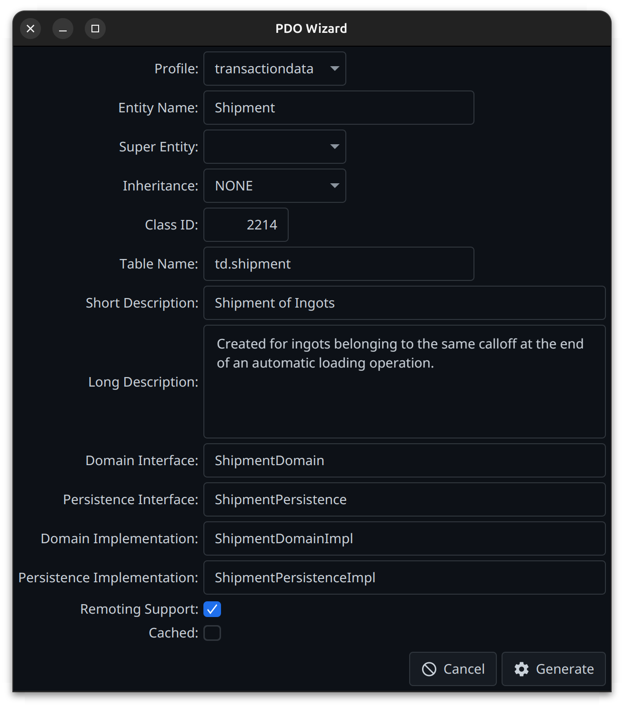
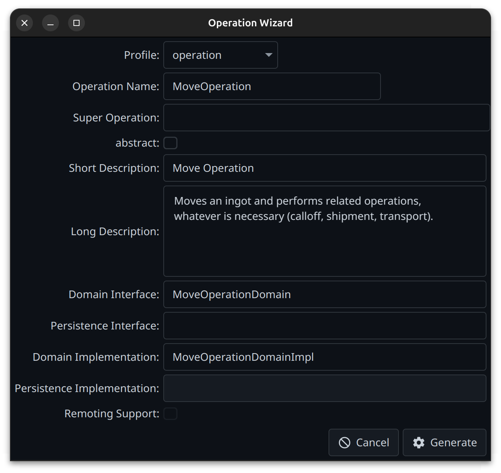
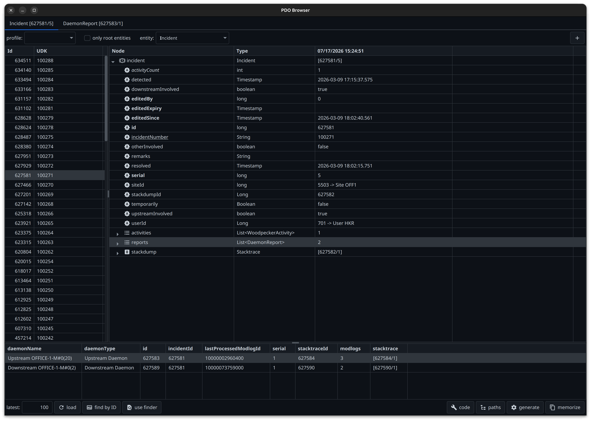
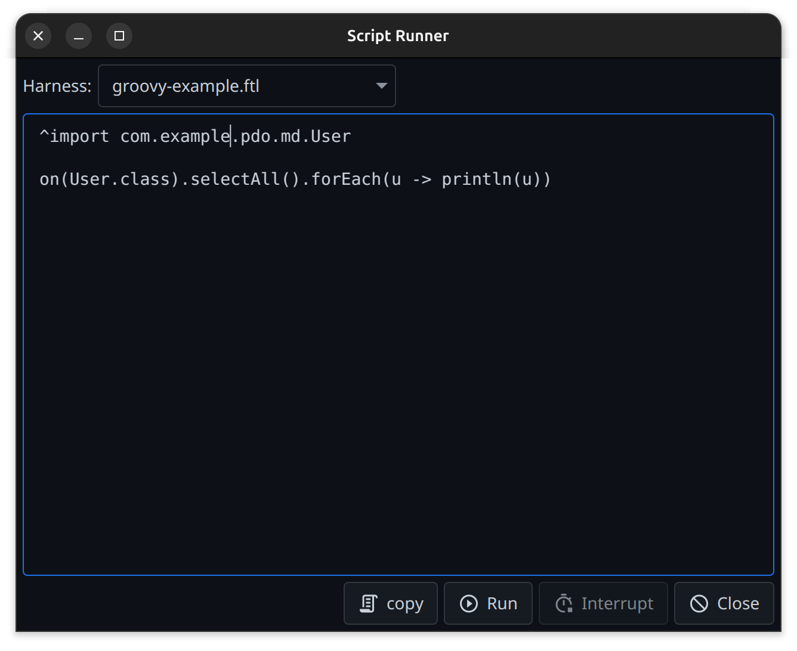

# The Tentackle Wizard Maven Plugin

The `tentackle-wizard-maven-plugin` is a developer productivity tool. While the
[`tentackle-maven-plugin`](../../../../tentackle-maven-plugin/src/main/docs/tentackle-maven-plugin.md)
and the wurbelizer take care of *generating* the persistence layer from an existing
[model](../../../../tentackle-model/src/main/docs/model-definition.md), the wizard plugin helps you
*author* the source files that carry that model in the first place.

It scaffolds the Java source files for new
[PDOs](../../../../tentackle-pdo/src/main/docs/pdo.md) and
[operations](../../../../tentackle-pdo/src/main/docs/operation.md), filling in the boilerplate
(interfaces, implementations, the model comment block, class IDs, package declarations,
wurblet anchors) so that all you have to do afterward is describe the attributes and write the business
logic. Its goals open an interactive JavaFX wizard, but the `pdo`, `operation`, `browse`, and `script`
goals can also run unattended in batch mode.

All goals share the prefix `tentackle-wizard`, so they can be invoked directly from the command line,
e.g. `mvn tentackle-wizard:pdo`.

### Prerequisites

The plugin requires the same JDK and Maven versions as the rest of the framework
(JDK >= 25, Maven >= 3.9.10, Maven 4 is supported as well). Because the wizards are JavaFX applications, the interactive goals
(`pdo`, `operation`, `browse`, `script`) need a graphical desktop; if the UI cannot be started, the goal
fails. The `browse` and `script` goals additionally need a reachable Tentackle backend (database or
remote server). The `init` goal and the batch variants of `pdo`, `operation`, `browse`, and `script` run
headless (the batch variants of `browse` and `script` still need a reachable backend).

All goals are **aggregator goals** and operate on the whole reactor. They are therefore best invoked
from the directory of the project's maven parent (the aggregator pom), so that the wizard sees every
module and can place the generated files into the correct ones.

### Overview of Goals

| Goal        | Mode                | Purpose                                                                        |
|-------------|---------------------|--------------------------------------------------------------------------------|
| `pdo`       | interactive / batch | Create the source files for a new Persistent Domain Object.                    |
| `operation` | interactive / batch | Create the source files for a new Operation (behavior without an entity).      |
| `browse`    | interactive / batch | Connect to a backend, browse persisted PDOs and generate test code.            |
| `script`    | interactive / batch | Connect to a backend and run scripts (Groovy, Ruby, …) against it.             |
| `init`      | headless            | (Re)install the default code-generation templates into the template directory. |
| `help`      | —                   | Print plugin usage information (generated by the maven-plugin-plugin).         |

### Common Configuration

Like all Tentackle mojos, the goals inherit the common parameters `verbosity`, `skip`, `charset`,
`jdkToolchain` and `minLogLevel` (see the [`tentackle-maven-plugin` docs](../../../../tentackle-maven-plugin/src/main/docs/tentackle-maven-plugin.md#common-configuration)).
In addition to the model and profile parameters described below, all goals share:

- `templateDir`: the directory holding the code-generation templates. Defaults to
  `${project.basedir}/templates`. If it does not exist, it is created and the default templates are
  installed; see [Templates](#templates).
- `statusDir`: the directory for the wizard's status files, such as the next free class ID per
  profile (see [Class IDs](#class-ids)). Defaults to `${project.build.directory}/wizard`. It should be
  located below the target directory, so that `mvn clean` removes it.
- `darkMode`: `true` or `false` forces the dark or light variant of the UI theme. If unset, the mode
  follows the desktop setting and changes along with it.
- `themeName`: the [AtlantaFX](../../../../tentackle-fx-atlanta/src/main/docs/atlanta.md) theme of the
  wizard dialogs: `Primer`, `Cupertino` or `Nord`. Defaults to `Cupertino` on macOS and `Primer` elsewhere.
- `profiles`: the profiles described below. Required by the `pdo` and `operation` goals; the `browse`
  goal uses the configured `PdoProfile`s, if any, to filter its entity list.

All goals are thread-safe. They share the loaded model, the code factory settings and the JavaFX
platform, however, so in a parallel build (`mvn -T …`) concurrent executions are serialized; see
[Parallel builds](../../../../tentackle-maven-support/src/main/docs/tentackle-maven-support.md#parallel-builds).

### How the Wizard Places Files: the Model and Profiles

To know *where* a generated file belongs, the plugin needs two kinds of information.

**The model.** All goals except `init` load the application's
[model](../../../../tentackle-model/src/main/docs/model-definition.md) so the wizard knows which
entities, class IDs, and table names already exist (and can prevent collisions). By default, the model
is read from the dependencies on the plugin classpath (`loadModelFromDependencies = true`) and from
`${project.build.directory}/wurbel/model`. The relevant parameters, shared by all goals through the
common base, are:

- `modelName` (`tentackle.modelName`): the model to load. Defaults to the standard model name.
- `modelDir` (`tentackle.modelDir`): directory holding the model files. Defaults to
  `${project.build.directory}/wurbel/model`. Ignored if `filesets` is given.
- `filesets`: explicit file sets holding the model, overriding `modelDir`. Each file set is loaded as a
  whole directory (includes and excludes are not applied); a file set without a directory defaults to
  `modelDir`.
- `modelDefaults` (`tentackle.modelDefaults`) and `entityAliases` (`tentackle.entityAliases`):
  model defaults and entity aliases to apply to all model sources while loading, in the same syntax as
  in the model source.
- `loadModelFromDependencies`: also load the model from the resources of the plugin's dependencies
  (default `true`).
- `layers` / `leafLayer`: an alternative to declaring the application's PDO/domain/persistence
  dependencies as plain `<dependency>` elements of the plugin, for applications that are themselves
  built with isolated [module layers](../../../../tentackle-common/src/main/docs/layers.md) — for
  example, when two dependencies need different, otherwise conflicting versions of the same module.
  When configured, the goal builds the layer graph and runs against the `leafLayer`'s classloader
  instead of the plain plugin classpath; see *Isolated Module Layers* below.

**Profiles.** A `profile` tells the wizard the target packages and naming for a *class* of objects.
Almost every Tentackle application groups its entities (e.g., master data vs. transactional data), and
each group typically lives in its own set of packages and its own range of class IDs. You declare one
`<profile>` per group in the `<profiles>` configuration; the wizard offers them for selection (or, in
batch mode, picks one per entity by stereotype). Profile names must be unique.

All profiles (for both `pdo` and `operation`) share these elements:

- `name` (required): the unique profile name.
- `domainPackage`, `persistencePackage`, `domainImplPackage`, `persistenceImplPackage` (required):
  the target packages for the domain/persistence interfaces and their implementations. Each package
  must be mapped to exactly one module of the reactor, otherwise the goal fails. This is how the
  wizard decides which module a file goes into (and a requirement for JPMS since split packages are
  not allowed in modular projects).
  The mapping is derived from the **directories** found in the compile source roots, so every package
  named in a profile must already exist as a directory — an empty one is enough. A package that does
  not exist anywhere belongs to no module and the goal aborts with
  `cannot determine module for package …`; the same empty package in two modules aborts with
  `empty split package detected`. This bites on the first operation of a freshly generated project,
  see [The First Operation](../../../../src/main/docs/quickstart.md#the-first-operation-jpms-does-not-come-for-free).
- `domainInterface`, `persistenceInterface`, `domainImplementation`, `persistenceImplementation`
  (optional): override the default super types (`DomainObject`, `PersistentObject`,
  `AbstractDomainObject`, `AbstractPersistentObject`) for the generated types.

`PdoProfile` adds:

- `pdoPackage` (required): the package of the PDO interface.
- `pdoInterface` (optional): the super PDO interface, defaults to `PersistentDomainObject`.
- `minClassId` (required) / `maxClassId` (optional): the range of class IDs reserved for this
  profile. IDs below 100 are reserved for Tentackle and rejected. See [Class IDs](#class-ids) below.
- `tablePrefix` (optional): a prefix prepended to table names entered in the wizard, typically a schema
  such as `md.`. This ends up in the model and is **not** the same as `@TableName.prefix` (see
  [Table Names](../../../../tentackle-session/src/main/docs/table-names.md)).

`OperationProfile` adds:

- `operationPackage` (required): the package of the operation interface.
- `operationInterface` (optional): the super operation interface, defaults to `Operation`.

### The `pdo` Goal

This is the main goal. It creates the set of source files for a new PDO:

- the PDO interface (carrying the model comment block),
- the domain interface and the persistence interface,
- the domain implementation and the persistence implementation.

Each file is written into the directory of the module that owns its package, as derived from the
selected profile.

**The goal does not write the remote delegate.** Enabling remoting only *tailors* the generated
files: the persistence implementation gets the import of the delegate interface (the matching
`getRemoteDelegate()` accessor is woven in later by the `MethodsImpl` wurblet). The delegate pair itself —
`<persistenceImplPackage>.trip.<Name>RemoteDelegate` and `…RemoteDelegateImpl`, see
[Naming Rules](../../../../tentackle-common/src/main/docs/naming-rules.md) — is created *when needed* by the
[persistence wurblets](../../../../tentackle-persistence-wurblets/src/main/docs/persistence-wurblets.md):
`AssertRemote` and every other remote-capable wurblet construct `RemoteIncludes`, which generates the
two files from the `RemoteInterface.ftl` and `RemoteImplementation.ftl` templates if they do not exist
yet. Those templates are installed by the wizard (see *Templates* below), but never used by its goals.
For a PDO this is automatic: the generated persistence implementation carries the `MethodsImpl`
wurblet anchor, so the delegates appear on the next build.

**Interactive mode** (the default) opens the *PDO Wizard*, a JavaFX dialog. You pick a profile,
enter the entity name, choose the inheritance type and the super entity (if any), the table name (pre-filled
with the profile's `tablePrefix`), whether caching and remoting are enabled, and a description. The wizard validates the input live against the model — it refuses entity
names, class IDs, and table names that already exist, and enforces the rules that follow from the
chosen inheritance type (for example, an embedded entity gets no class ID and no caching). The next
free class ID is pre-filled from the profile's range.



**Batch mode** is enabled by configuring `batchFilesets` or `batchDir`. Instead of opening the UI, the goal reads a
secondary model from those file sets and generates the code for every entity it contains that does not
yet exist in the project model. Entities that already exist are skipped with a warning. All other
entities are processed, and if any of them could not be generated — no matching profile, a validation
error (for example, a class ID or table name already in use), or a failing template — the goal fails at
the end with the list of these entities. This is handy for bootstrapping a project from an existing schema
(e.g., a model dumped by the `tentackle-sql-maven-plugin`, or reverse-engineered from a *live* database
by that same plugin's
[`reveng` goal](../../../../tentackle-sql-maven-plugin/src/main/docs/tentackle-sql-maven-plugin.md#the-reveng-goal)).
Batch parameters:

- `batchFilesets`: the file sets holding the secondary model, in plain model format (as used in the
  wurbelizer here-docs, or as dumped with `dumpAsComment` and `dumpVariables` both `false`).
  Directories default to the project base directory. The whole directory is loaded to resolve the
  relations, but code is only generated for the entities of the included files.
- `batchDir` (`-DbatchDir`): the command-line alternative to `batchFilesets`. All files in that
  single directory are read as model input, e.g. the output of `tentackle-sql:reveng`. A relative path
  is resolved against the project base directory.
- If more than one `PdoProfile` is configured, each entity must select its profile via a stereotype
  matching the profile name (case-insensitive), e.g. `#MASTERDATA`. With a single profile, entities
  without such a stereotype use that profile.
- `batchModelDefaults` (`-DbatchDefaults`): model defaults applied when printing the model source into
  the generated PDO interfaces. Defaults to `!ROOT, !ROOTID, !ROOTCLASSID, !BIND, UNTRACKED` to suppress
  unwanted entity options, since the dumped model usually already has the project defaults baked in.
- `dumpColumnGap` (default `2`): minimum number of spaces between columns in the generated attribute
  section of the model source.
- `dumpAnnotationsAsOptions`: which annotations to render as attribute options in the generated model
  source (e.g. `@NotNull|, @NotZero`; `@*` matches all, a trailing `|` matches only parameterless
  annotations).

The class ID of an entity is taken from the batch model if it lies within the profile's range;
otherwise, the entity gets the next free class ID of the profile. The table name is taken verbatim —
unlike the interactive wizard, batch mode does not prepend the profile's `tablePrefix`. Remoting follows
the project's model defaults.

At least one `PdoProfile` must be configured or the goal fails.

### The `operation` Goal

The counterpart to `pdo` for [operations](../../../../tentackle-pdo/src/main/docs/operation.md) —
domain behavior that is not bound to a persistent entity. It generates the operation interface, the
domain and persistence interfaces and their implementations. Configuration mirrors `pdo` but uses
`OperationProfile`s; at least one must be configured. There is no class-ID handling (operations have
no class IDs).

As for the `pdo` goal, the remote delegate is **not** generated here; remoting only adds the delegate
import and the `getRemoteDelegate()` override to the persistence implementation. Unlike a PDO, a
generated operation implementation contains no wurblet anchor at all, so the delegate pair is created
on the first build in which the implementation carries a remote-capable wurblet — either an explicit
`// @wurblet <tag> AssertRemote` or the `RemoteMethod` blocks the operation needs anyway.

**The profile packages must exist before the first run.** In a project generated by the
[archetype](../../../../tentackle-project-archetype/src/main/docs/tentackle-project-archetype.md) the
`operation` profile is preconfigured, but its packages do not exist yet — there is no operation to
put in them — so the first invocation fails with `cannot determine module for package …`. Nor can
they be declared in `module-info.java` up front: javac rejects an `exports` for a package holding no
compilation unit. Create the directories, run the goal, then add the `exports`; the one-time sequence
is spelled out in
[The First Operation](../../../../src/main/docs/quickstart.md#the-first-operation-jpms-does-not-come-for-free).

**Interactive mode** (the default) opens the *Operation Wizard*. You pick a profile, enter the
operation name and a description, optionally a super operation, and decide whether the operation is
abstract and whether remoting is supported. The names of the four generated types are derived from
the operation name as you type; clearing one of them suppresses the corresponding file.



**Batch mode** is entered as soon as `operationName` is set. Since operations are not part of the
model, there is no input file to read from: every value the dialog would ask for is given as a
parameter, and one invocation generates exactly one operation.

```bash
mvn tentackle-wizard:operation \
    -DoperationName=SendInvoice \
    -Dcomment="sends an invoice to the customer" \
    -Dremote=true
```

| Parameter (`-D…`)           | Meaning                                                                                             |
|-----------------------------|-----------------------------------------------------------------------------------------------------|
| `operationName`             | The operation interface name. **Setting it enables batch mode.**                                    |
| `profile`                   | The `OperationProfile` to use, matched case-insensitively. Optional if only one is configured.      |
| `comment`                   | The short description. Mandatory — the generator rejects an operation without one.                  |
| `longComment`               | The long description.                                                                               |
| `remote`                    | Whether remoting is supported. Only tailors the generated persistence implementation (delegate import and `getRemoteDelegate()`); it does not generate the delegate. Defaults to `true` if the project has no model defaults, otherwise to their `remote` option. |
| `superOperation`            | The super operation, determining all five super types. Defaults to the profile / framework types.   |
| `abstract`                  | Generate an abstract operation (default `false`).                                                   |
| `domainInterface`           | Override the derived name. An empty value or `-` generates no domain interface and no domain implementation. |
| `persistenceInterface`      | Likewise for the persistence side. Suppressing it also disables remoting.                           |
| `domainImplementation`      | Override the derived name; an empty value or `-` generates the interface without an implementation. Ignored if the domain interface is suppressed. |
| `persistenceImplementation` | Likewise for the persistence implementation.                                                        |
| `overwrite`                 | Allow regenerating over existing files (default `false`).                                           |

At least one of the domain and persistence sides must remain, otherwise the goal fails.

The table lists the user properties. When configuring the goal in the POM instead, use the parameter
names, which differ for five of them: `profileName` (`profile`), `shortDescription` (`comment`),
`longDescription` (`longComment`), `remoteEnabled` (`remote`) and `abstractOperation` (`abstract`).

Two differences to the `pdo` goal are worth knowing:

- **The goal fails, it does not warn.** An invalid or incomplete operation aborts the build with the
  validation messages, and an unknown profile name aborts it with the list of configured profiles.
- **Existing files are not overwritten.** Because an operation is not part of the model, nothing else
  can detect that it already exists; the goal therefore checks the target files up front and fails
  unless `-Doverwrite=true` is given. This protects business logic added to a previously generated
  operation.

### The `browse` Goal

Connects to a running backend and generates test code (Java fixtures) from persisted PDOs. It is the
tool of choice for building realistic integration-test data from existing records — see
[tentackle-test-pdo](../../../../tentackle-test-pdo/src/main/docs/tentackle-test-pdo.md#generating-fixture-code-with-the-pdo-browser)
for the step-by-step recipe that feeds the generated code into the test base classes.

Common parameters (valid in both modes):

- `url` (required): the backend URL.
- `user` (required) / `password`: the backend credentials.
- `maxLinesInStringLiteral` (`-DmaxLines`): caps the number of lines emitted in generated multi-line
  string literals. 0 (the default) means unlimited.
- `mapSchemas` (`tentackle.mapSchemas`): map schema names to flat table names in the generated SQL
  `SELECT` statements. Set it to the same value as everywhere else in the project — see
  [Table Names](../../../../tentackle-session/src/main/docs/table-names.md).

If no backend can be reached, the goal fails with a clear message.

#### Interactive Mode: the PDO Browser

Interactive mode is the default — it opens the *PDO Browser*, which lets you navigate the PDOs
persisted in the database along their relations, compare them over time, and generate test code (Java
fixtures and the corresponding SQL) from the objects you select. It connects with the credentials
given above and runs against the *live* backend, so pointing it at a development or staging database
rather than production is a good idea. Note that the browser only *reads* — it never writes to the
database.

**The browser shows the Java view of your data, not the SQL view.** This is the whole point: it does
not display database columns but the *properties of the PDO*, read through their getters, in the very
form the application sees them. An enum shows up as its constant, not as the number or character
stored in the column; a `Money`, a `Timestamp`, or any application-specific data type shows up as its
formatted Java value, not as its raw column representation; a component or a collection is a subtree,
not a foreign key. Node names are Java property names, and the `Type` column shows the Java type.
Outgoing relations are followed for you: the referenced object is rendered by its unique domain key,
and its full data is one click away in the details table at the bottom. In other words, you are
browsing objects, not rows — the database columns only surface where you explicitly ask for them, via
*copy table name*, *copy SQL SELECT…* and *copy SQL SELECT statements of referencing PDOs…* in the context menus.



The window is organized into two toolbars and three data areas, the latter resizable via split panes:

| Area                            | Contents                                                                                    |
|---------------------------------|---------------------------------------------------------------------------------------------|
| top toolbar                     | *profile*, *only root entities*, *entity*, and the **+** button (browse in new tab).          |
| left table                      | the loaded PDOs, with their object ID and their unique domain key (*UDK*). Multi-selectable. |
| right tree table                | the object tree of the PDO selected on the left, optionally diffed against a memorized state.|
| bottom table                    | the row details of the tree node selected above.                                             |
| bottom toolbar                  | loading on the left (*latest*, *load*, *find by ID*, *use finder*), code generation on the right (*code*, *paths*, *generate*, *memorize*). |

##### Choosing the Entity

The *entity* combo box lists every persistable entity of the application. Two filters narrow it down:
the *profile* choice box restricts the list to the entities of one [profile](#how-the-wizard-places-files-the-model-and-profiles)
(i.e. one PDO package), and *only root entities* hides the components of aggregates. Embedded entities
are never listed.

The list is sorted by camel-case letters and renders them in bold, and typing selects by camel-case
prefix — entering `CO` jumps to `CustomerOrder`. Selecting an entity immediately loads its records.

##### Loading PDOs

- **latest** / **load** — loads the *n* most recently created PDOs of the entity (default 100). Changing
  the count reloads immediately; *load* re-runs the query.
- **find by ID** — opens a popup to enter one or more object IDs, separated by whitespace, commas,
  colons, semicolons, or slashes. The objects found are inserted at the top of the table and *added* to
  what is already loaded; entering `0` as the first ID clears the table first. IDs that do not exist or
  are already loaded are skipped, non-numeric input is rejected with a warning, and a short note reports
  how many PDOs were added. Input without any valid ID leaves the table unchanged.
- **use finder** — opens the application's own search dialog for that entity and lists its result.
  Cancelling or closing the dialog returns to the latest PDOs. The button is only enabled if the
  application provides a
  [`GuiProvider`](../../../../tentackle-fx-rdc/src/main/docs/gui-provider.md) with a finder for the
  entity, which requires the application's [RDC](../../../../tentackle-fx-rdc/src/main/docs/rdc.md)
  layer on the plugin classpath.

The context menu of the table adds **reload**, which re-reads the selected PDOs from the database —
the fastest way to see what an application function has just changed (see *memorize* below). Below it
sit the standard Tentackle table features: *auto adjust* column widths, *print*, *export to
spreadsheet* (all or selected rows; CSV, or XLS if `tentackle-fx-rdc-poi` is on the plugin classpath),
*export to XML*, saving and loading the table preferences, and a row counter.

##### Inspecting the Object Tree

Selecting a PDO on the left expands it into the tree table on the right: its attributes, its embedded
and composite components, and its collections, recursively. Every node is read through the PDO's
getters, so the `Type` column shows the Java type (`Timestamp`, `List<DaemonReport>`, an enum, a custom
data type, …) and the value column its formatted Java value — never the underlying column type or its
encoded representation. For an object node the value is `[<id>/<serial>]`.

Outgoing (non-composite) 1:1 relations are resolved for display: an ID-carrying attribute shows
`5503 -> Site OFF1`, i.e. the referenced object's unique domain key next to the raw ID, and selecting
it brings up that object's data in the details table below. N:M links are likewise shown as the object
they point to rather than as the link entity. A relation is only resolved this way if the referenced
entity provides a unique domain key; otherwise the attribute stays a plain ID.

The rendering carries meaning:

| Rendering              | Meaning                                                                       |
|------------------------|-------------------------------------------------------------------------------|
| **bold**               | an implicit attribute — supplied by the model or the framework, not authored by you (`id`, `serial`, `editedBy`, …). |
| underlined             | part of the entity's unique domain key.                                       |
| *italic*               | a hidden component or attribute — no public getter available.                  |
| highlighted row        | the node differs from the memorized state (see below).                        |
| tooltip                | the comment of the attribute or relation, taken from the model.               |

The context menu offers, depending on the selected node:

- **show differences only** / **show all lines** — only present when a state has been memorized; filters
  the tree down to the differing nodes and expands them.
- **copy FQCN … to clipboard** — the fully qualified class name of the selected object.
- **copy table name … to clipboard** — its database table.
- **copy SQL SELECT… to clipboard** — a ready-to-run `SELECT` that fetches exactly this node: for an
  object node the row itself, for an attribute node all rows carrying that value. Inheritance is taken
  into account (single-table and joined-table hierarchies produce the appropriate column lists and
  joins), so that an attribute declared in an abstract entity only matches the rows of its concrete
  sub entities, and `mapSchemas` controls whether schema names are mapped to flat table names. The item
  is hidden for embedded objects and for attributes whose data type spans several columns.
- **copy SQL SELECT statements of referencing PDOs to clipboard** — the opposite direction: a script answering
  *who points at this object?*, derived from the model. It holds one `SELECT` per referencing table
  and column, each preceded by a comment naming the referencing entity and attribute, grouped into
  three sections: *references* (the non-composite relations — the ones that keep the object from being
  deleted), *components* (the parts of its aggregate, found via their foreign key), and, for a root
  entity, *aggregate members* (every component of the whole aggregate at once, found via its
  `rootId`/`rootClassId` columns). Relations declared on either side are picked up, references to a
  super-entity are included, and references living in an embedded type resolve to the prefixed column
  of the embedding table. The item is only shown for object nodes.
- **copy class-ID … to clipboard** — the class ID of the selected object.
- **browse in new tab** — opens the selected object, or the object referenced by the selected
  attribute, in a new browser tab (see [Working with Several Views](#working-with-several-views)).

Plus the standard table features described above, extended by *expand* and *collapse* for the subtree
of the selected node.

##### The Row Details Table

Selecting a node in the tree fills the table at the bottom, which renders objects as rows and their
attributes as columns — the compact, tabular counterpart to the tree:

- an **object** node yields a single row,
- a **list** node yields one row per element, which makes comparing the elements of a collection much
  easier than expanding them one by one in the tree,
- an **attribute** node carrying an outgoing relation yields the *referenced* PDO — clicking the
  `userId` of an incident shows the user's own data, without having to look up the ID in another table.
  This is the browser's way of navigating relations: one click down the reference, and *browse in new
  tab* below if you want to keep it.

Its context menu repeats *copy FQCN*, *copy table name*, *copy class-ID*, *copy SQL SELECT…* and
*copy SQL SELECT statements of referencing PDOs…*, and adds two items of its own:

- **copy Java code to clipboard** — generates the fixture code for that single object. There is no
  path configuration here, but it is the quickest way to create the referenced master data an object
  depends on.
- **browse in new tab** — opens the object in a new browser tab, which is how you follow a relation
  without losing the current view.

##### Comparing States: *memorize*

The **memorize** toggle button remembers the currently selected PDO — the whole object tree, timestamped.
The tree table then shows two value columns, headed by the load time and the memorize time, and rows
that differ are highlighted; *show differences only* reduces the tree to just those rows.

The typical workflow is: select the PDO, press *memorize*, run the function under test in the
application, then *reload* the PDO from the table's context menu and look at what changed. Memorization
survives a reload, but is dropped when a different entity is selected.

Differences are determined by value as well as by object ID and `serial`, so an object replaced by
another one is detected too. Implicit attributes and the IDs of composite relations are ignored, since
they carry no domain information. Collections are matched up by ID, regardless of the order in which
they were loaded, and N:M collections by the object the link points to, so inserted and deleted elements
show up as gaps on one side rather than shifting everything below them.

##### Working with Several Views

The **+** button in the top toolbar opens the object selected in the tree table — for an attribute
holding a relation, the referenced object — in a new tab, as does *browse in new tab* in the context
menus of the tree and the row details table. If the row details table was focused more recently than
the tree, **+** opens its selected object instead. If there is no such selection, **+** duplicates the
current view — same entity, same selected PDO — into a new tab. The first new tab turns the window into
a tab pane; each tab is titled after its selected object (or its entity, when nothing is selected),
so several objects can be inspected side by side. Tabs are closable except for the first one, and
closing them until one is left restores the plain single view.

##### Generating the Code

Select one or more PDOs in the left table and press **generate**: the browser builds the Java code that
recreates them — `on(…)`, the attribute setters, the components and collections, and a final `save()` —
and copies it to the clipboard, prefixed with a comment recording the generation time, the user, the
host, and the session it came from. A note confirms what was copied.

Two buttons configure the result:

- **code** — the code settings popup, holding the same two options as the batch parameters
  `-Ddistinct` and `-Doffset`: whether each generated instance gets its own numbered variable name, and
  which number to start at. With distinct variables, the generated code ends in `persist()` rather than
  `save()`, so each object stays available under its own name. The settings are applied when the popup
  closes and last until the goal ends.
- **paths** — a list of check boxes for the *code paths* of the current selection, i.e. the dotted paths
  of the attributes and relations that may be included or excluded. The list is derived from the model
  and only offers what is actually configurable: attributes and relations carrying the `NOTEST`
  stereotype (unchecked by default), multi-line string attributes, and N:M relation lists (both checked
  by default). The button stays disabled when the selection has nothing to configure.

The `maxLinesInStringLiteral` parameter (`-DmaxLines`) additionally caps how much of a long text ends
up in the generated string literals. Hidden components — those without a public accessor — are
generated as comments, since the generated code could not call them.

##### Preferences

*save user preferences* in the context menu of either table stores its column layout (order, widths,
visibility, sorting) under the `PdoBrowser` node of `java.util.prefs`, separately from the
application's own preferences. *save system preferences* ends up in the same user node. Both tables load their preferences on startup, and the initial divider
positions of the split panes follow the stored table widths — so arranging the browser once makes it
come up that way from then on.

#### Batch Mode

Batch mode runs headless and writes the Java fixture code for a known set of objects straight to a
file, without opening the UI. It is enabled by supplying both the `pdo` and the `output` parameters;
supplying only one of them fails the goal. This is handy for regenerating fixtures in a scripted or CI
setting once you know which records you want. The objects are selected by entity name and object ID;
if the entity is unknown or any ID cannot be found in the database, the goal fails.

Batch parameters (supplying both `pdo` and `output` switches the goal into batch mode):

- `pdo` (`-Dpdo`): the objects to generate code for, in the form `<entity>[<id>,<id>,...]`, where
  the square brackets are literal, `entity` is the entity name (the simple name of the PDO interface)
  and each `id` is an object ID, separated by commas or spaces. At least one ID is required.
  Example: `-Dpdo=Customer[17878,221221,333]`.
- `output` (`-Doutput`): the file the generated Java code is written to (parent directories are
  created as needed).
- `distinct` (`-Ddistinct`): by default the variable names of the created entities are reused for the
  2nd, 3rd, … instance. When `true`, the variable names are numbered instead.
- `offset` (`-Doffset`): when `distinct` is `true`, the number the variable names start at. If unset,
  the first instance is left unnumbered. Ignored without `distinct`.

In the POM, these parameters are named `pdoConfig`, `outputFile`, `distinctVariables` and
`variableOffset`; the short names above are their user properties.

### The `script` Goal

Runs [Tentackle scripts](../../../../tentackle-core/src/main/docs/scripting.md) against a live
backend, either interactively (edit and run in a JavaFX window) or unattended in batch mode. It is the
tool of choice for ad-hoc data fixes, one-off migrations, or exploring persisted data with the full
domain model at hand — the script runs with the application's dependencies on the classpath, so it can
use `on()` and `op()` exactly like application code.



The key concept is the **harness**. The code you write is only a *fragment*; it is woven into a
harness, a FreeMarker template that owns the boilerplate: it implements a
`DomainContextProvider` (so `on()`/`op()` resolve), and defines the `run()` method your fragment is
inserted into. The script runs within the session opened by the goal. Harnesses are supplied by the
developer. The **first line of a harness is a she-bang** selecting the scripting language (`#!groovy`,
`#!gv`, `#!ruby`, …);
it is stripped and does not land in the generated script. The scripting language provider (e.g.
`tentackle-script-groovy`) must be on the plugin classpath, added as a `<dependency>` of the plugin
(this is unaffected by `layers` below — only the *application's own* dependencies typically need
isolating, not the scripting language provider itself).

Since the fragment lands inside the `run()` method, it cannot contain import statements itself.
Instead, the fragment marks import lines with a leading `^`-sign:

```groovy
^import org.tentackle.misc.*
^import java.time.LocalDate
```

Every line starting with an `^`-sign is removed from the fragment, stripped of
the `^`-sign, and handed to the harness via the `imports` variable, which places it at the top level
of the generated script. The mechanism is language-agnostic — in a Ruby fragment, `^require 'json'`
becomes a top-level `require 'json'`.

When weaving, FreeMarker exposes four variables to the harness template:

- `content`: the script fragment, inserted into the harness's `run()` method,
- `imports`: the import statements extracted from the fragment, one per line,
- `language`: the scripting language name,
- `harness`: the harness filename.

An example Groovy harness (`groovy-example.ftl`) is installed alongside the `pdo`/`operation` templates (see
*Templates* below) and can be used as a starting point.

Parameters:

- `url` (required): the backend URL.
- `user` (required) / `password`: the backend credentials.
- `harnesses` (optional): the filesets holding the harness templates (instead of the default from the template directory).
  Harness filenames must be unique across all filesets.
- `harness` (`-Dharness`): pre-selects a harness by filename (without a directory). In batch mode it
  selects which harness to weave into; it may be omitted if exactly one harness is configured. In
  interactive mode it pre-selects the combo box entry. An unknown harness fails the goal in both modes.
- `script` (`-Dscript`): the path to a file holding the fragment, relative to the project base
  directory. **If given, the goal runs headless in batch mode**, weaves the fragment into the selected
  harness, and runs it. If omitted, the interactive editor opens instead.

**Interactive mode** opens a window with a combo box to choose the harness, a text area to edit the
fragment, and the buttons *Load*, *Save*, *Save as*, *copy*, *Run*, *Interrupt* and *Close*. *Run*
executes the edited fragment on a worker thread; *Interrupt* interrupts that thread. Interruption is
cooperative — a long-running fragment must check `Thread.currentThread().isInterrupted()` in its loops
to be interruptible. *copy* puts the generated script — the fragment woven into the selected harness —
on the clipboard.

The fragment can be kept on disk: *Load* reads it from a file, *Save* writes it back to the file it
came from (asking for one if there is none), and *Save as* always asks. Files are read and written as
UTF-8. The name of the current file is shown next to the harness combo box, followed by an asterisk
while there are unsaved changes; closing the editor with unsaved changes or while a script is still
running asks for confirmation (a running script is interrupted). The
file used last is remembered per user and project and is reloaded the next time the editor comes up,
so a session can be continued where it left off. A saved fragment is exactly what batch mode expects,
which makes for a natural round trip: develop the fragment interactively, save it, then run it
unattended with `-Dscript=<file>`.

**Batch mode** (`-Dscript=<file>`) reads the fragment from disk and runs it once, failing the build
with the script error if compilation or execution fails.

Since the goal runs with the application's dependencies on the classpath, starting it as a **debug
session from within the IDE** lets you debug any code in the application's code base. Set a breakpoint,
let the script run into it, and inspect or evaluate whatever you need — for example, evaluate a
`Permission` with the [`SecurityManager`](../../../../tentackle-pdo/src/main/docs/security.md) right
in the debugger.

### Isolated Module Layers

All goals normally run against the plain plugin classpath, populated the usual way: the application's
PDO, domain, and persistence artifacts (and, for `script`, the scripting language provider) declared
as `<dependency>` elements of the plugin itself. This is enough as long as nothing on that combined
classpath conflicts — but if the application is itself built with isolated
[module layers](../../../../tentackle-common/src/main/docs/layers.md) (see
`tentackle-jlink-maven-plugin`'s `layers`/`leafLayer` configuration), or two of its dependencies need
different, otherwise conflicting versions of the same module, a single flat classpath cannot represent
that: Maven itself only ever resolves one version per `groupId:artifactId`.

Configuring `layers` and `leafLayer` on this plugin builds the same kind of `ModuleLayer` graph
in-process, at goal-execution time, and installs the `leafLayer`'s classloader as the thread's context
classloader for the duration of the goal — the same mechanism `LayerBootstrap` uses for a packaged
application, just without a separate process. Every existing, layer-unaware resource- and
service-lookup already used by the model loading and by `browse`/`script`'s `Pdo.createSession(...)`
call transparently resolves from within that leaf layer.

```xml
<layers>
  <layer>
    <name>app-model</name>
    <dependencies>
      <dependency>
        <groupId>com.example</groupId>
        <artifactId>app-model</artifactId>
        <version>2.0</version>
      </dependency>
    </dependencies>
  </layer>
</layers>
<leafLayer>app-model</leafLayer>
```

Each `<layer>` has a `name` (unique among all configured layers), an optional comma-separated `parent`
(other layer names it is built on top of; empty means parented directly on the boot layer), and
`dependencies` — plain Maven coordinates, resolved independently of the plugin's own dependency graph,
exactly as if the layer were its own tiny project. `leafLayer` must name one of the configured layers;
if `layers` is empty (the default), this feature is inactive and every goal behaves exactly as before
it existed.

### The `init` Goal

Copies the bundled default templates into the template directory, **overwriting** any existing files
there. The wizard installs the templates automatically the first time it runs (when the template
directory does not yet exist), so you normally only need `init` to reset customized templates back to
their defaults. The goal neither loads the model nor needs any profile.

### Templates

All generated source is produced from [FreeMarker](https://freemarker.apache.org/) templates. They
live under the `templateDir` parameter (default `${project.basedir}/templates`), organized into
categories matching the goals: `pdo/`, `operation/`, and `script/`. The `pdo/` and `operation/`
categories hold one `*.ftl` per generated artifact, e.g. `pdo/PdoInterface.ftl`,
`pdo/DomainImplementation.ftl`, `operation/OperationInterface.ftl`, and so on. The `script/` category
holds a single `groovy-example.ftl` — an example Groovy harness you can copy and adapt for the `script`
goal.

Two templates are the exception: `RemoteInterface.ftl` and `RemoteImplementation.ftl` (in both `pdo/`
and `operation/`) correspond to no file any goal writes. The wizard only *installs* them; they are
rendered later by the
[persistence wurblets](../../../../tentackle-persistence-wurblets/src/main/docs/persistence-wurblets.md),
which look them up under `templateDir` or `<projectRoot>/templates/{pdo|operation}` when a remote
delegate is missing. Customize them the same way — but keep them, or the wurbelizer run terminates
when it needs to generate a delegate.

Because the templates are plain files in your project, you can customize them — adjust the license
header, add house-style javadoc, change default imports — and every subsequently generated file will
follow your conventions. Run `tentackle-wizard:init` to restore the originals.

### Class IDs

Every root PDO needs a unique, stable class ID used by the persistence layer. The `pdo` goal manages these automatically:

- Each `PdoProfile` declares a `minClassId` (and optionally a `maxClassId`). When `maxClassId` is
  omitted, the range ends right below the `minClassId` of the next higher profile; the profile with the
  highest `minClassId` is unbounded. Ranges must not overlap — two profiles with the same `minClassId`,
  or a `maxClassId` reaching into the next profile's range, fail the goal.
- Before each run, the wizard scans the model for the highest class ID already used per profile and
  pre-selects the next free one. In an unused range, this is the `minClassId` itself.
- To stay consistent across several PDOs generated without an intermediate `mvn clean`/wurbel run,
  the next free ID per profile is recorded in a status file `<profile>.classid` in the
  `statusDir` (default `${project.build.directory}/wizard`). Because this lives under `target`, it is
  cleaned by `mvn clean`. Within a single batch run, the entities without a class ID of their own get
  consecutive IDs.

If a profile runs out of free class IDs, the goal warns; reserved IDs below 100 are rejected.

### Example Configuration

```xml
<plugin>
  <groupId>org.tentackle</groupId>
  <artifactId>tentackle-wizard-maven-plugin</artifactId>
  <version>${project.version}</version>
  <configuration>
    <profiles>
      <profile>
        <!-- a PdoProfile -->
        <name>masterdata</name>
        <pdoPackage>com.example.app.pdo</pdoPackage>
        <domainPackage>com.example.app.domain</domainPackage>
        <persistencePackage>com.example.app.persistence</persistencePackage>
        <domainImplPackage>com.example.app.domain.impl</domainImplPackage>
        <persistenceImplPackage>com.example.app.persistence.impl</persistenceImplPackage>
        <minClassId>1000</minClassId>
        <maxClassId>1999</maxClassId>
        <tablePrefix>md_</tablePrefix>
      </profile>
    </profiles>
    <!-- only needed if the application's dependencies must be isolated, see "Isolated Module Layers" -->
    <!--
    <layers>
      <layer>
        <name>app-model</name>
        <dependencies>
          <dependency>
            <groupId>com.example</groupId>
            <artifactId>app-model</artifactId>
            <version>2.0</version>
          </dependency>
        </dependencies>
      </layer>
    </layers>
    <leafLayer>app-model</leafLayer>
    -->
  </configuration>
</plugin>
```

With this in place:

```bash
# scaffold a new PDO interactively
mvn tentackle-wizard:pdo

# scaffold a new operation interactively
mvn tentackle-wizard:operation

# scaffold a new operation headless, everything from the command line
mvn tentackle-wizard:operation -DoperationName=SendInvoice -Dcomment="sends an invoice"

# browse a backend and generate test code interactively
mvn tentackle-wizard:browse

# generate fixture code for selected objects headless, straight to a file
mvn tentackle-wizard:browse -Dpdo=Customer[17878,221221,333] -Doutput=target/fixtures/Customers.java

# run scripts against a backend interactively (edit + run in a window)
mvn tentackle-wizard:script

# run a single script fragment headless, weaving it into groovy-example.ftl
mvn tentackle-wizard:script -Dscript=src/scripts/fix-orders.groovy

# reverse-engineer two tables of an existing database (tentackle-sql-maven-plugin's reveng goal),
# then scaffold PDOs from the result
mvn tentackle-sql:reveng -Dtentackle.reveng.url=jdbc:postgresql://localhost/legacydb \
                          -Dtentackle.reveng.user=app -Dtentackle.reveng.tables=CUSTOMER,ORDER_ITEM
mvn tentackle-wizard:pdo -DbatchDir=target/reveng-model

# restore the default templates
mvn tentackle-wizard:init
```

Run these from the aggregator (parent) directory so the wizard can place files into all modules.

### The Skills

The goals that run headless are the ones a coding agent can drive, and `src/skills/` in this
module holds one ready-made agent skill per goal, describing when and how to use it and what goes wrong
in batch mode:

| Skill                        | Goal                          |
|------------------------------|-------------------------------|
| `tentackle-pdo-wizard`       | `tentackle-wizard:pdo`        |
| `tentackle-operation-wizard` | `tentackle-wizard:operation`  |
| `tentackle-pdo-browser`      | `tentackle-wizard:browse`     |
| `tentackle-script-runner`    | `tentackle-wizard:script`     |

The `tentackle-sql-maven-plugin` ships a matching `tentackle-sql-reveng` skill for its `reveng` goal
(see [its own doc](../../../../tentackle-sql-maven-plugin/src/main/docs/tentackle-sql-maven-plugin.md#the-skills)),
the natural first step before this plugin's `pdo` goal when bootstrapping from an existing database.

They are templates: copy the ones you want into your own project, alongside the `tentackle-model` skill
of the [MCP plugin](../../../../tentackle-mcp-maven-plugin/src/main/docs/tentackle-mcp-maven-plugin.md).

```bash
mkdir -p .claude/skills
cp -r path/to/tentackle-wizard-maven-plugin/src/skills/* .claude/skills/
```

Agents that do not support skills can be pointed at the same files as plain instructions — in
`AGENTS.md`, in `CLAUDE.md`, or in whatever the tool calls its project context. See
[AI Agent Tooling Support](../../../../src/main/docs/ai-agents.md) for how the goals fit together into
one workflow.

### How It Fits Into the Workflow

The wizard is a one-shot authoring tool, not part of the regular build lifecycle:

1. `tentackle-wizard:pdo` / `:operation` — scaffold the source files for a new domain object.
2. You fill in the attributes in the model comment block and add the business logic.
3. The normal build (`tentackle:analyze` → wurbelizer → compiler) then generates the persistence
   mappings and SQL from that model, exactly as described in the
   [Tentackle Maven Plugin](../../../../tentackle-maven-plugin/src/main/docs/tentackle-maven-plugin.md)
   documentation.

### Further Reading

- [AI Agent Tooling Support](../../../../src/main/docs/ai-agents.md) — driving the `pdo`, `operation`,
  `browse` and `script` goals headless from a coding agent, together with the model MCP server
- [PDO — Persistent Domain Objects](../../../../tentackle-pdo/src/main/docs/pdo.md)
- [Operation — Behavior Without an Entity](../../../../tentackle-pdo/src/main/docs/operation.md)
- [Tentackle Model Definition Syntax](../../../../tentackle-model/src/main/docs/model-definition.md)
- [ModuleLayer](../../../../tentackle-common/src/main/docs/layers.md) — isolated dependency sets via `layers`/`leafLayer`
- [The Tentackle Maven Plugin](../../../../tentackle-maven-plugin/src/main/docs/tentackle-maven-plugin.md)
- [Validation](../../../../tentackle-core/src/main/docs/validation.md)
- [Plugin reference (generated)](https://tentackle.org/tentackle/tentackle-wizard-maven-plugin/plugin-info.html)
```
